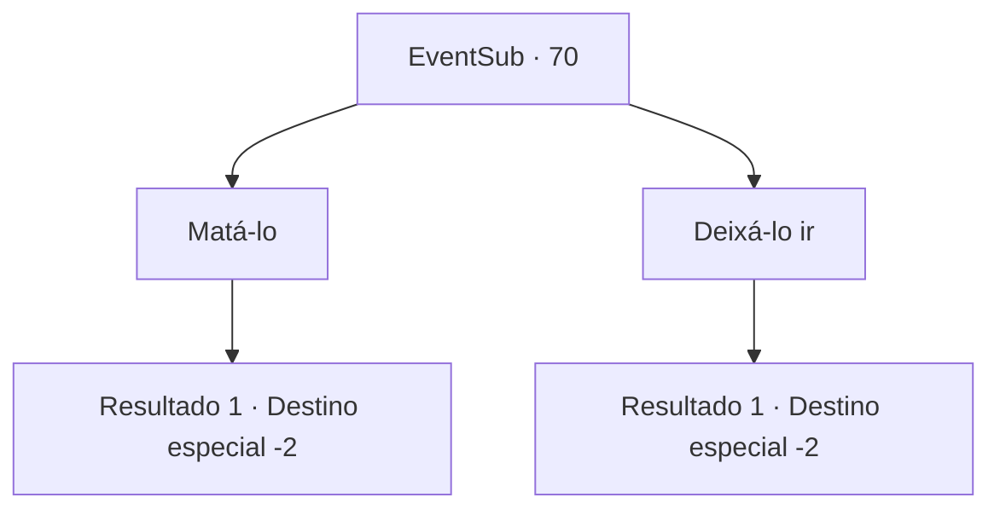

# Eventos secundários · 70

[Índice da tabela](index.md) · [Índice geral](../index.md)

ID: `pt:EventSub:70` · Fonte: `EventSub4` · Versão: 1.2.47.

Mapeamento estático dos arquivos; a disponibilidade e a execução dependem do estado da run.

## Texto do evento

|drawing_church| Você chega à igreja em Alengrad. Você espera lá até o anoitecer, enquanto Enard sai das sombras. Ele olha ao redor antes de entrar na igreja. Então ele vê você e fica pálido como se tivesse visto um fantasma.

## Dados de entrada

```json
{
  "id": 70,
  "grade": 1,
  "subEvent": "2",
  "required": "12_2_10"
}
```

## Mapa das escolhas



## Escolhas e resultados

### Escolha 1

Matá-lo

Requisitos e outros campos da escolha:

```json
{
  "required": "2_3_10"
}
```

#### Resultado 1.1

Acabar com a vida dele é fácil. Ele não viu isso chegando e, portanto, está completamente vulnerável. Você ataca a cabeça dele com toda a sua força e logo ele para de se mover. Alengrad é uma cidade grande com um bom número de guardas, mas felizmente nenhum deles está por perto para te ver. Você sai o mais rápido possível.

Continuação registrada: [Destino especial `-2`](../destinos-especiais.md).

```json
{
  "required": "",
  "chance": "1",
  "nextEvent": -2,
  "type": 2,
  "reward": "0_3_-5|0_2_2|12_2_-1|14_2_6"
}
```

### Escolha 2

Deixá-lo ir

Requisitos e outros campos da escolha:

```json
{
  "required": ""
}
```

#### Resultado 2.1

Você o perdoa. Ele olha para trás várias vezes enquanto foge.

Continuação registrada: [Destino especial `-2`](../destinos-especiais.md).

```json
{
  "required": "",
  "chance": "1",
  "nextEvent": -2,
  "type": 2,
  "reward": "0_3_10|0_2_2|12_2_-1|14_2_7"
}
```

## Referências que chegam a este evento

Nenhum `nextEvent` positivo da mesma tabela aponta para este nó. Isso não prova que seja inacessível: sorteio e estado de história podem selecioná-lo.

