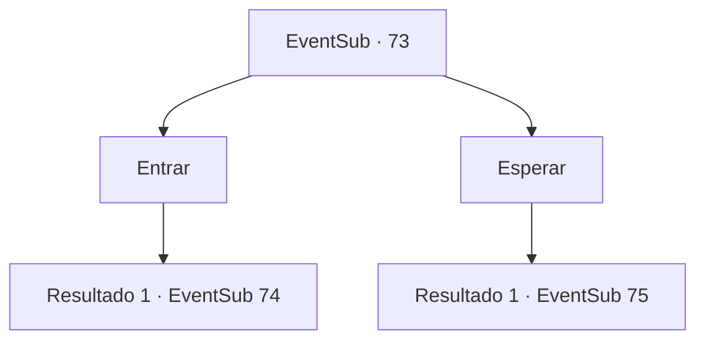

# Eventos secundários · 73

[Índice da tabela](index.md) · [Índice geral](../index.md)

ID: `pt:EventSub:73` · Fonte: `EventSub4` · Versão: 1.2.47.

Mapeamento estático dos arquivos; a disponibilidade e a execução dependem do estado da run.

## Texto do evento

De repente começa a chover. Você está encharcado quando chega à casa de Majet. Você deveria ir pescar com ela. Mas parece que ninguém está em casa.

## Dados de entrada

```json
{
  "id": 73,
  "grade": 2,
  "subEvent": "",
  "required": "5_91_1|5_17_4|12_0_-1|18_92_3|18_92_4"
}
```

## Mapa das escolhas



## Escolhas e resultados

### Escolha 1

Entrar

Requisitos e outros campos da escolha:

```json
{
  "required": ""
}
```

#### Resultado 1.1

Você abre cuidadosamente a porta. Ela não está trancada. Não há ninguém dentro, mas a casa está uma bagunça. Você corre para fora e bate na porta de um vizinho. Uma mulher atende. 

 "Posso ajudar você..?"

 Você explica o que aconteceu e pergunta onde está Majet, a caçadora. Ela franze a testa e pergunta. 

 "Eu sei onde ela está... mas quem é você?"


Continuação registrada: [Evento 74](0074.md) na mesma tabela.

```json
{
  "required": "",
  "chance": "1",
  "nextEvent": 74,
  "type": 2,
  "reward": "5_91_2"
}
```

### Escolha 2

Esperar

Requisitos e outros campos da escolha:

```json
{
  "required": ""
}
```

#### Resultado 2.1

Você espera pacientemente do lado de fora da casa. 10 minutos depois, uma mulher sai de uma casa vizinha. Ela olha para o chão e chuta a sujeira enquanto fala. 

 "Você quer saber onde encontrá-la?"


Continuação registrada: [Evento 75](0075.md) na mesma tabela.

```json
{
  "required": "",
  "chance": "1",
  "nextEvent": 75,
  "type": 2,
  "reward": "5_91_2"
}
```

## Referências que chegam a este evento

Nenhum `nextEvent` positivo da mesma tabela aponta para este nó. Isso não prova que seja inacessível: sorteio e estado de história podem selecioná-lo.

