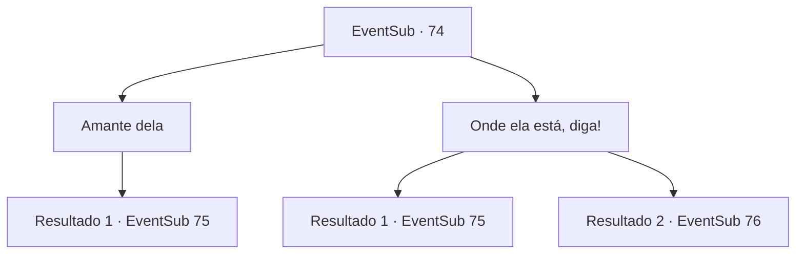

# Eventos secundários · 74

[Índice da tabela](index.md) · [Índice geral](../index.md)

ID: `pt:EventSub:74` · Fonte: `EventSub4` · Versão: 1.2.47.

Mapeamento estático dos arquivos; a disponibilidade e a execução dependem do estado da run.

## Texto do evento

*Sem texto no arquivo.*

## Dados de entrada

```json
{
  "id": 74,
  "grade": 1,
  "subEvent": "",
  "required": ""
}
```

## Mapa das escolhas



## Escolhas e resultados

### Escolha 1

Amante dela

Requisitos e outros campos da escolha:

```json
{
  "required": ""
}
```

#### Resultado 1.1

Ela exclama surpresa antes de continuar. 

 "Entendi, entendi. Eu estava lavando roupa quando um grupo de homens invadiu a casa dela e sequestrou a jovem no local! Eles ameaçaram arrancar meus olhos, então eu voltei para dentro."

 Ela acrescenta que talvez consiga lembrar para onde eles a levaram com um pequeno incentivo.

Continuação registrada: [Evento 75](0075.md) na mesma tabela.

```json
{
  "required": "",
  "chance": "1",
  "nextEvent": 75,
  "type": 2,
  "reward": "5_91_2"
}
```

### Escolha 2

Onde ela está, diga!

Requisitos e outros campos da escolha:

```json
{
  "required": ""
}
```

#### Resultado 2.1

Surpreendida e ofendida, ela grita de volta. 

 "Está descontando isso em mim? Mudei de ideia, desapareça!"


Continuação registrada: [Evento 75](0075.md) na mesma tabela.

```json
{
  "required": "",
  "chance": "7",
  "nextEvent": 75,
  "type": 1,
  "reward": "5_91_2"
}
```

#### Resultado 2.2

A mulher está intimidada com suas ameaças. Sua voz treme enquanto ela responde. 

 "Eu estava lavando roupa quando um grupo de homens invadiu a casa dela, -e sequestrou a jovem no local! Eles ameaçaram arrancar meus olhos, então eu voltei para dentro."

 Então ela aponta para o leste. 

 "Eles... foram por ali. Isso é tudo que eu sei."

 Você imediatamente começa a correr para o leste. Logo, você os encontra em um beco escuro. Eles têm a Majet amarrada em um cavalo. Ela parece inconsciente.

Continuação registrada: [Evento 76](0076.md) na mesma tabela.

```json
{
  "required": "",
  "chance": "1|0_12_1",
  "nextEvent": 76,
  "type": 0,
  "reward": "5_91_2"
}
```

## Referências que chegam a este evento

- [Evento 73 · escolha 1 · resultado 1](0073.md#escolha-1)
