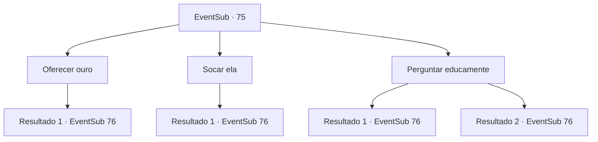

# Eventos secundários · 75

[Índice da tabela](index.md) · [Índice geral](../index.md)

ID: `pt:EventSub:75` · Fonte: `EventSub4` · Versão: 1.2.47.

Mapeamento estático dos arquivos; a disponibilidade e a execução dependem do estado da run.

## Texto do evento

*Sem texto no arquivo.*

## Dados de entrada

```json
{
  "id": 75,
  "grade": 1,
  "subEvent": "",
  "required": ""
}
```

## Mapa das escolhas



## Escolhas e resultados

### Escolha 1

Oferecer ouro

Requisitos e outros campos da escolha:

```json
{
  "required": "1_4_10"
}
```

#### Resultado 1.1

Você entrega a ela 10 ouros. Ela mal consegue conter seu sorriso enquanto aponta para o leste. 

 "Eles foram por ali. Tenha cuidado. Eles não pareciam muito...amigáveis."

 Você imediatamente começa a correr para o leste. Logo, você os encontra em um beco escuro. Eles têm Majet amarrada em cima de um cavalo. Ela parece inconsciente.

Continuação registrada: [Evento 76](0076.md) na mesma tabela.

```json
{
  "required": "",
  "chance": "1",
  "nextEvent": 76,
  "type": 2,
  "reward": "0_4_-10|0_3_1|0_2_1"
}
```

### Escolha 2

Socar ela

Requisitos e outros campos da escolha:

```json
{
  "required": "2_3_0"
}
```

#### Resultado 2.1

Você deixa seus punhos falarem. Ela aponta para o leste com o dedo trêmulo. 

 "Eles... foram por ali. Isso é tudo que eu sei."

 Você imediatamente começa a correr para o leste. Logo, você os encontra em um beco escuro. Eles têm Majet amarrada em cima de um cavalo. Ela parece inconsciente.

Continuação registrada: [Evento 76](0076.md) na mesma tabela.

```json
{
  "required": "",
  "chance": "1",
  "nextEvent": 76,
  "type": 2,
  "reward": "0_3_-5"
}
```

### Escolha 3

Perguntar educamente

Requisitos e outros campos da escolha:

```json
{
  "required": "1_3_0"
}
```

#### Resultado 3.1

Você pergunta em um tom educado desesperado. Ela cede e aponta para o leste. 

 "Eles foram por ali. Tenha cuidado. Eles não pareciam muito...amigáveis."

 Você imediatamente começa a correr para o leste. Logo, você os encontra em um beco escuro. Eles têm Majet amarrada em cima de um cavalo. Ela parece inconsciente.

Continuação registrada: [Evento 76](0076.md) na mesma tabela.

```json
{
  "required": "",
  "chance": "1",
  "nextEvent": 76,
  "type": 2,
  "reward": "0_3_1"
}
```

#### Resultado 3.2

Você pergunta em um tom desesperado e desconfortável. Ela suspira enquanto aponta para o leste. 

 "Você realmente deveria trabalhar suas habilidades sociais... Tenha cuidado. Eles não pareciam muito...amigáveis."

 Você imediatamente começa a correr para o leste. Logo, você os encontra em um beco escuro. Eles têm Majet amarrada em cima de um cavalo. Ela parece inconsciente.

Continuação registrada: [Evento 76](0076.md) na mesma tabela.

```json
{
  "required": "2_7_9",
  "chance": "1",
  "nextEvent": 76,
  "type": 2,
  "reward": "0_3_1"
}
```

## Referências que chegam a este evento

- [Evento 73 · escolha 2 · resultado 1](0073.md#escolha-2)
- [Evento 74 · escolha 1 · resultado 1](0074.md#escolha-1)
- [Evento 74 · escolha 2 · resultado 1](0074.md#escolha-2)
