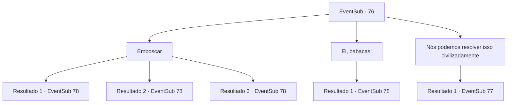

# Eventos secundários · 76

[Índice da tabela](index.md) · [Índice geral](../index.md)

ID: `pt:EventSub:76` · Fonte: `EventSub4` · Versão: 1.2.47.

Mapeamento estático dos arquivos; a disponibilidade e a execução dependem do estado da run.

## Texto do evento

*Sem texto no arquivo.*

## Dados de entrada

```json
{
  "id": 76,
  "grade": 1,
  "subEvent": "",
  "required": ""
}
```

## Mapa das escolhas



## Escolhas e resultados

### Escolha 1

Emboscar

Requisitos e outros campos da escolha:

```json
{
  "required": ""
}
```

#### Resultado 1.1

Tentas emboscar os sequestradores de Majet, mas és avistado. Eles reconhecem-te e tu reconheces-os. Eles são da patrulha de fronteira, os mesmos que prenderam Majet antes. 

 "É ele! Morre, seu idiota!"

 Olhos injetados de raiva, eles avançam contra ti com as suas armas.

Continuação registrada: [Evento 78](0078.md) na mesma tabela.

```json
{
  "required": "",
  "chance": "20",
  "nextEvent": 78,
  "type": 1,
  "reward": "6_3_21",
  "place": 4
}
```

#### Resultado 1.2

Você se aproxima sorrateiramente dos sequestradores de Majet sem ser notado. Então você pega uma adaga do coldre de um dos bandidos e a enfia em sua caixa torácica. Ele grita e os outros se viram. Eles te reconhecem e você os reconhece. Eles são da patrulha de fronteira, aqueles que prenderam Majet antes. 

 "É ele! Morra, seu filho da...!"

 Furiosos de raiva, eles avançam em sua direção com suas armas.

Continuação registrada: [Evento 78](0078.md) na mesma tabela.

```json
{
  "required": "",
  "chance": "1|0_6_1",
  "nextEvent": 78,
  "type": 0,
  "reward": "6_2_21",
  "place": 4
}
```

#### Resultado 1.3

Você se aproxima sorrateiramente dos sequestradores de Majet sem ser notado. Então você pega uma adaga do coldre de um dos bandidos e a enfia em sua caixa torácica. Ele grita e os outros se viram. Eles te reconhecem e você os reconhece. Eles são da patrulha de fronteira, aqueles que prenderam Majet antes. 

 "É ele! Morra, seu filho da...!"

 Furiosos de raiva, eles avançam em sua direção com suas armas.

Continuação registrada: [Evento 78](0078.md) na mesma tabela.

```json
{
  "required": "20_5_1",
  "chance": "1|0_6_1",
  "nextEvent": 78,
  "type": 0,
  "reward": "6_2_21",
  "place": 4
}
```

### Escolha 2

Ei, babacas!

Requisitos e outros campos da escolha:

```json
{
  "required": ""
}
```

#### Resultado 2.1

Você grita nas costas deles. Eles viram a cabeça e imediatamente te reconhecem. Eles são da patrulha de fronteira, aqueles que prenderam Majet antes. 

 "É ele! Morra, seu filho da...!"

 Olhos vermelhos de raiva, eles avançam em sua direção com suas armas.

Continuação registrada: [Evento 78](0078.md) na mesma tabela.

```json
{
  "required": "",
  "chance": "1",
  "nextEvent": 78,
  "type": 2,
  "reward": "6_0_21",
  "place": 4
}
```

### Escolha 3

Nós podemos resolver isso civilizadamente

Requisitos e outros campos da escolha:

```json
{
  "required": ""
}
```

#### Resultado 3.1

Você tenta falar com eles. Eles viram a cabeça e imediatamente te reconhecem. Eles são da patrulha de fronteira, aqueles que prenderam Majet antes. 

 "Escute esse palhaço falar... Nós perdemos nossos empregos por sua causa e dessa mulher. E agora você quer conversar?"

 Então outro guarda interrompe. 

 "Bem, vamos deixar você ir embora se pagar 2000 ouros, hehe."


Continuação registrada: [Evento 77](0077.md) na mesma tabela.

```json
{
  "required": "",
  "chance": "1",
  "nextEvent": 77,
  "type": 2,
  "reward": ""
}
```

## Referências que chegam a este evento

- [Evento 74 · escolha 2 · resultado 2](0074.md#escolha-2)
- [Evento 75 · escolha 1 · resultado 1](0075.md#escolha-1)
- [Evento 75 · escolha 2 · resultado 1](0075.md#escolha-2)
- [Evento 75 · escolha 3 · resultado 1](0075.md#escolha-3)
- [Evento 75 · escolha 3 · resultado 2](0075.md#escolha-3)
