# Eventos secundários · 77

[Índice da tabela](index.md) · [Índice geral](../index.md)

ID: `pt:EventSub:77` · Fonte: `EventSub4` · Versão: 1.2.47.

Mapeamento estático dos arquivos; a disponibilidade e a execução dependem do estado da run.

## Texto do evento

*Sem texto no arquivo.*

## Dados de entrada

```json
{
  "id": 77,
  "grade": 1,
  "subEvent": "",
  "required": ""
}
```

## Mapa das escolhas

```mermaid
flowchart TD
  E["EventSub · 77"]
  C0["Pagar eles"]
  E --> C0
  R0_0["Resultado 1 · EventSub 79"]
  C0 --> R0_0
  C1["Vai se ferrar&#x27;"]
  E --> C1
  R1_0["Resultado 1 · EventSub 78"]
  C1 --> R1_0
```



## Escolhas e resultados

### Escolha 1

Pagar eles

Requisitos e outros campos da escolha:

```json
{
  "required": "1_4_2000"
}
```

#### Resultado 1.1

Você paga como eles desejam. Eles parecem surpresos quando você deitou um grande bolso de ouro após o outro. 

 "Whoah ... não esperava isso."

 "Bem, uh ... obrigado. Vamos deixar nossos rancores no passado."

 Eles deixam Majet ir, E você a traz de volta para a casa dela. 

 Algum tempo depois, Majet murmura algo enquanto abre os olhos. Seus olhos se arregalam quando ela vê você. 

 "{1}? Mas como?"

 Um momento de silêncio antes de falar novamente. 

 "Você salvou minha vida, novamente ... obrigado. Mas não tenho mais nada para lhe oferecer em troca."


Continuação registrada: [Evento 79](0079.md) na mesma tabela.

```json
{
  "required": "",
  "chance": "1",
  "nextEvent": 79,
  "type": 2,
  "reward": "0_3_5|0_4_-2000|0_2_1"
}
```

### Escolha 2

Vai se ferrar'

Requisitos e outros campos da escolha:

```json
{
  "required": ""
}
```

#### Resultado 2.1

2000 ouro é um preço insano. A raiva toma conta da razão. Você acerta um deles na mandíbula. 

 "Argh! Morra, seu filho da...!"

 Olhos injetados de ódio, eles avançam em sua direção com suas armas.

Continuação registrada: [Evento 78](0078.md) na mesma tabela.

```json
{
  "required": "",
  "chance": "1",
  "nextEvent": 78,
  "type": 2,
  "reward": "6_0_21",
  "place": 4
}
```

## Referências que chegam a este evento

- [Evento 76 · escolha 3 · resultado 1](0076.md#escolha-3)
