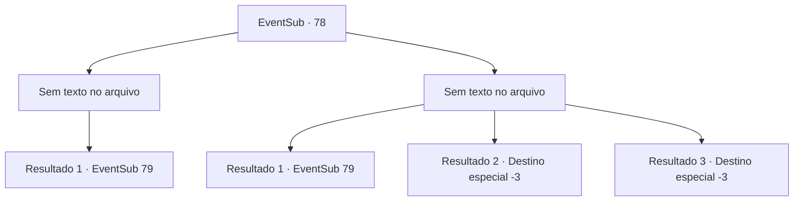

# Eventos secundários · 78

[Índice da tabela](index.md) · [Índice geral](../index.md)

ID: `pt:EventSub:78` · Fonte: `EventSub4` · Versão: 1.2.47.

Mapeamento estático dos arquivos; a disponibilidade e a execução dependem do estado da run.

## Texto do evento

*Sem texto no arquivo.*

## Dados de entrada

```json
{
  "id": 78,
  "grade": 1,
  "subEvent": "",
  "required": ""
}
```

## Mapa das escolhas



## Escolhas e resultados

### Escolha 1

*Sem texto no arquivo; o papel dessa opção depende da interface do jogo.*

Requisitos e outros campos da escolha:

```json
{
  "required": ""
}
```

#### Resultado 1.1

Você bateu os ex-seguradores de patrulha e avisa que nunca mais voltarão. Eles mancam, completamente derrotados. Você traz Majet de volta para a casa dela. 

 Algum tempo depois, ela murmura algo enquanto abre os olhos. Seus olhos se arregalam quando ela vê você. 

 "{1}? Mas como?"

 Há um momento de silêncio antes de ela falar novamente. 

 "Você salvou minha vida, novamente ... obrigado. Mas não tenho mais nada para lhe oferecer em troca."


Continuação registrada: [Evento 79](0079.md) na mesma tabela.

```json
{
  "required": "",
  "chance": "1",
  "nextEvent": 79,
  "type": 2,
  "reward": ""
}
```

### Escolha 2

*Sem texto no arquivo; o papel dessa opção depende da interface do jogo.*

Requisitos e outros campos da escolha:

```json
{
  "required": ""
}
```

#### Resultado 2.1

Você foi espancado pelos ex-guardas. Nesse momento, os oficiais da patrulha da cidade apareceram, e os ex-guardas fugiram, deixando você e Majet para trás. Com o corpo ferido, você levou Majet de volta para a casa dela. 

 Depois de algum tempo, Majet soltou um gemido baixo e abriu os olhos. Ela te olhou surpresa, arregalando os olhos, e disse: 

 "Ah... {1}... como...?"

 Depois de um breve silêncio, ela falou novamente: 

 "Te devo a vida mais uma vez. Obrigada... Mas agora não tenho mais nada para te dar, e aí?"


Continuação registrada: [Evento 79](0079.md) na mesma tabela.

```json
{
  "required": "1_0_2|1_1_2",
  "chance": "1",
  "nextEvent": 79,
  "type": 2,
  "reward": "0_0_-1|0_1_-1|0_2_1"
}
```

#### Resultado 2.2

Os ex-guardas da patrulha de fronteira te espancam até a morte.

Continuação registrada: [Destino especial `-3`](../destinos-especiais.md).

```json
{
  "required": "2_0_2",
  "chance": "1",
  "nextEvent": -3,
  "type": 2,
  "reward": "0_0_-1|0_1_-1"
}
```

#### Resultado 2.3

Os ex-guardas da patrulha de fronteira te espancam até a morte.

Continuação registrada: [Destino especial `-3`](../destinos-especiais.md).

```json
{
  "required": "2_1_2",
  "chance": "1",
  "nextEvent": -3,
  "type": 2,
  "reward": "0_0_-1|0_1_-1"
}
```

## Referências que chegam a este evento

- [Evento 76 · escolha 1 · resultado 1](0076.md#escolha-1)
- [Evento 76 · escolha 1 · resultado 2](0076.md#escolha-1)
- [Evento 76 · escolha 1 · resultado 3](0076.md#escolha-1)
- [Evento 76 · escolha 2 · resultado 1](0076.md#escolha-2)
- [Evento 77 · escolha 2 · resultado 1](0077.md#escolha-2)
