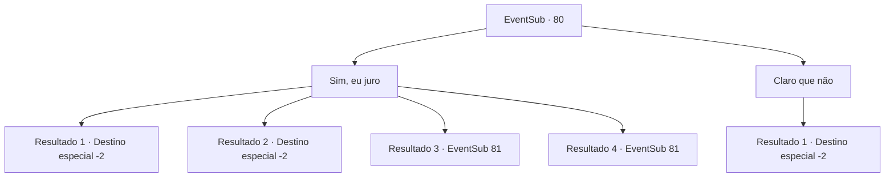

# Eventos secundários · 80

[Índice da tabela](index.md) · [Índice geral](../index.md)

ID: `pt:EventSub:80` · Fonte: `EventSub4` · Versão: 1.2.47.

Mapeamento estático dos arquivos; a disponibilidade e a execução dependem do estado da run.

## Texto do evento

*Sem texto no arquivo.*

## Dados de entrada

```json
{
  "id": 80,
  "grade": 1,
  "subEvent": "",
  "required": ""
}
```

## Mapa das escolhas



## Escolhas e resultados

### Escolha 1

Sim, eu juro

Requisitos e outros campos da escolha:

```json
{
  "required": ""
}
```

#### Resultado 1.1

Você entrega a ela seu anel de prata e diz que está falando sério. Ela olha para ele, depois para você. Então ela afasta sua mão desconfortavelmente. 

 "Desculpe...isso tudo é um pouco repentino demais."

 Você sai da casa dela em constrangimento.

Continuação registrada: [Destino especial `-2`](../destinos-especiais.md).

```json
{
  "required": "8_46_1",
  "chance": "12",
  "nextEvent": -2,
  "type": 1,
  "reward": "5_91_4|14_0_6"
}
```

#### Resultado 1.2

Você olha para ela seriamente e diz a ela que você está falando sério. Ela afasta sua mão desconfortavelmente. 

 "Desculpe... isso tudo é um pouco repentino demais."

 Você sai da casa dela em constrangimento.

Continuação registrada: [Destino especial `-2`](../destinos-especiais.md).

```json
{
  "required": "10_46_1",
  "chance": "18",
  "nextEvent": -2,
  "type": 1,
  "reward": "5_91_4|14_0_6"
}
```

#### Resultado 1.3

Você entrega a ela seu anel de prata e diz que está falando sério. Ela olha para ele, depois para você. Então ela cora e desvia o olhar. 

 "Isso... tudo é um pouco repentino demais... Me dê um tempo para pensar."

 Ela gentilmente te afasta e entra em seu quarto.

Continuação registrada: [Evento 81](0081.md) na mesma tabela.

```json
{
  "required": "8_46_1",
  "chance": "1|0_12_1",
  "nextEvent": 81,
  "type": 0,
  "reward": "4_46_1"
}
```

#### Resultado 1.4

Você olha para ela seriamente e diz que está falando sério. Ela cora e desvia o olhar. 

 "Tudo isso é um pouco repentino... Me dê um tempo para pensar."

 Ela gentilmente te afasta e entra em seu quarto.

Continuação registrada: [Evento 81](0081.md) na mesma tabela.

```json
{
  "required": "10_46_1",
  "chance": "1|0_12_1",
  "nextEvent": 81,
  "type": 0,
  "reward": ""
}
```

### Escolha 2

Claro que não

Requisitos e outros campos da escolha:

```json
{
  "required": ""
}
```

#### Resultado 2.1

Pensei mesmo! Idiota bobo. Você age como se fosse tudo uma piada, e felizmente ela acredita nisso. Muito obrigado, aliás. Fique o tempo que quiser. Você descansa na casa de Majet. Então você parte em sua jornada enquanto ela se despede de você. Mas você não consegue evitar sentir um pouco de amargura.

Continuação registrada: [Destino especial `-2`](../destinos-especiais.md).

```json
{
  "required": "",
  "chance": "1",
  "nextEvent": -2,
  "type": 2,
  "reward": "0_0_1|5_91_4|14_0_5"
}
```

## Referências que chegam a este evento

- [Evento 79 · escolha 1 · resultado 1](0079.md#escolha-1)
