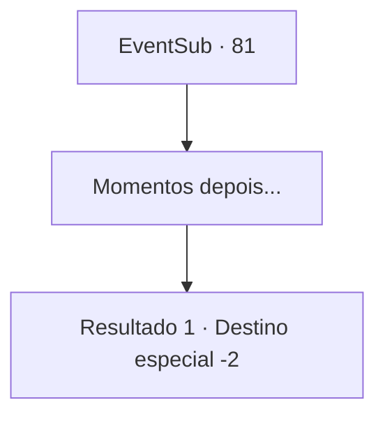

# Eventos secundários · 81

[Índice da tabela](index.md) · [Índice geral](../index.md)

ID: `pt:EventSub:81` · Fonte: `EventSub4` · Versão: 1.2.47.

Mapeamento estático dos arquivos; a disponibilidade e a execução dependem do estado da run.

## Texto do evento

*Sem texto no arquivo.*

## Dados de entrada

```json
{
  "id": 81,
  "grade": 1,
  "subEvent": "",
  "required": ""
}
```

## Mapa das escolhas



## Escolhas e resultados

### Escolha 1

Momentos depois...

Requisitos e outros campos da escolha:

```json
{
  "required": ""
}
```

#### Resultado 1.1

Majet volta logo em seguida. Ela responde beijando você na bochecha. O anel de prata já está em seu dedo. Ela ri um pouco de vergonha. 

 "Eu não sou muito boa com responsabilidades... Mas vou tentar!"

 Você passa algum tempo de qualidade com Majet. Então você parte em sua jornada enquanto ela se despede de você.

Continuação registrada: [Destino especial `-2`](../destinos-especiais.md).

```json
{
  "required": "",
  "chance": "1",
  "nextEvent": -2,
  "type": 2,
  "reward": "5_91_3|14_0_7"
}
```

## Referências que chegam a este evento

- [Evento 80 · escolha 1 · resultado 3](0080.md#escolha-1)
- [Evento 80 · escolha 1 · resultado 4](0080.md#escolha-1)
