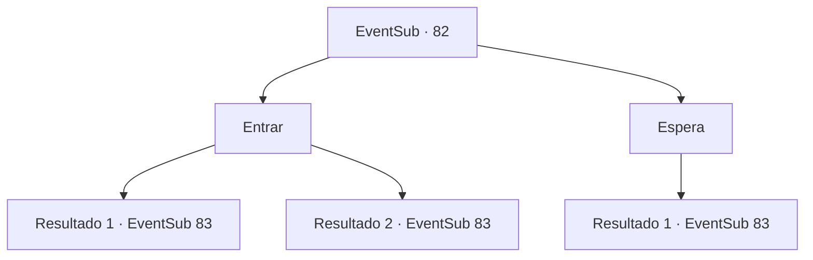

# Eventos secundários · 82

[Índice da tabela](index.md) · [Índice geral](../index.md)

ID: `pt:EventSub:82` · Fonte: `EventSub4` · Versão: 1.2.47.

Mapeamento estático dos arquivos; a disponibilidade e a execução dependem do estado da run.

## Texto do evento

De repente começa a chover. Você está encharcado quando chega à casa de Majet. Você deveria ir pescar com ela. Mas parece que ninguém está em casa.

## Dados de entrada

```json
{
  "id": 82,
  "grade": 2,
  "subEvent": "",
  "required": "18_91_1|18_91_3|18_91_4|5_17_4|12_0_-1|5_92_0"
}
```

## Mapa das escolhas



## Escolhas e resultados

### Escolha 1

Entrar

Requisitos e outros campos da escolha:

```json
{
  "required": ""
}
```

#### Resultado 1.1

Você bate na porta algumas vezes com o ombro, mas ela não se move. Você espera um pouco antes de Majet chegar à porta. Ela está apenas meio acordada. 

 "Desculpe... Eu bebi um pouco ontem à noite... Espere um pouco..."

 Ela fecha a porta atrás dela. Momentos depois, ela volta parecendo totalmente revigorada. 

 "Você trouxe sua vara de pesca, querido?"


Continuação registrada: [Evento 83](0083.md) na mesma tabela.

```json
{
  "required": "",
  "chance": "11",
  "nextEvent": 83,
  "type": 1,
  "reward": "5_92_1"
}
```

#### Resultado 1.2

Você bate com o ombro na porta. Majet pula do sofá da sala. 

 "Que diabos você está fazendo?"

 Ela te empurra de volta para fora da porta e te diz para esperar. Momentos depois, ela sai pela porta parecendo toda revigorada. 

 "Uh...desculpe por isso, eu bebi um pouco ontem à noite... Você trouxe sua vara de pesca?"


Continuação registrada: [Evento 83](0083.md) na mesma tabela.

```json
{
  "required": "",
  "chance": "1|0_5_1",
  "nextEvent": 83,
  "type": 0,
  "reward": "5_92_1"
}
```

### Escolha 2

Espera

Requisitos e outros campos da escolha:

```json
{
  "required": ""
}
```

#### Resultado 2.1

Você espera um pouco antes de Majet chegar à porta. Ela está apenas meio acordada. 

 "Desculpe...eu bebi um pouco ontem à noite... Espere um pouco..."

 Ela fecha a porta atrás dela. Momentos depois, ela volta parecendo toda revigorada. 

 "Querido, você trouxe sua vara de pesca?"


Continuação registrada: [Evento 83](0083.md) na mesma tabela.

```json
{
  "required": "",
  "chance": "1",
  "nextEvent": 83,
  "type": 2,
  "reward": "5_92_1"
}
```

## Referências que chegam a este evento

Nenhum `nextEvent` positivo da mesma tabela aponta para este nó. Isso não prova que seja inacessível: sorteio e estado de história podem selecioná-lo.

