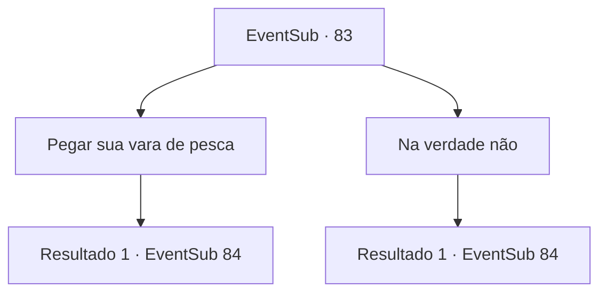

# Eventos secundários · 83

[Índice da tabela](index.md) · [Índice geral](../index.md)

ID: `pt:EventSub:83` · Fonte: `EventSub4` · Versão: 1.2.47.

Mapeamento estático dos arquivos; a disponibilidade e a execução dependem do estado da run.

## Texto do evento

*Sem texto no arquivo.*

## Dados de entrada

```json
{
  "id": 83,
  "grade": 1,
  "subEvent": "",
  "required": ""
}
```

## Mapa das escolhas



## Escolhas e resultados

### Escolha 1

Pegar sua vara de pesca

Requisitos e outros campos da escolha:

```json
{
  "required": "8_43_1"
}
```

#### Resultado 1.1

Você mostra a sua vara de pesca a ela. 

 "Ótimo, vamos lá."

 Majet lidera o caminho. Vocês dois chegam a um lago próximo. Alguns peixes saltam para a superfície e desaparecem de volta na água. Majet espera pacientemente enquanto ela olha sua bóia. 

 Assim como você está começando a ficar entediado, Sua vara se inclina para frente. Ela pega a vara e habilmente a enrola enquanto puxa. Logo, ela pega um salmão grande. Ela desafia você triunfantemente. 

 "Que tal uma aposta? Quem pega o maior peixe pode pedir um desejo!"


Continuação registrada: [Evento 84](0084.md) na mesma tabela.

```json
{
  "required": "",
  "chance": "1",
  "nextEvent": 84,
  "type": 2,
  "reward": ""
}
```

### Escolha 2

Na verdade não

Requisitos e outros campos da escolha:

```json
{
  "required": ""
}
```

#### Resultado 2.1

Você diz a ela que não tem uma vara de pesca com você. 

 "Tudo bem... Nós vamos revezar usando a minha então."

 Ela lidera o caminho. Os dois chegam a um lago próximo. Alguns peixes pulam até a superfície e desaparecem de volta na água. Majet espera pacientemente enquanto observa sua boia. Justo quando você está começando a ficar entediado, sua vara se curva para frente. Ela pega a vara e habilmente recolhe enquanto puxa. Logo depois, ela pega um grande salmão. Ela desafia você triunfantemente. 

 "E que tal uma aposta? Quem pegar o maior peixe pode fazer um pedido!"


Continuação registrada: [Evento 84](0084.md) na mesma tabela.

```json
{
  "required": "",
  "chance": "1",
  "nextEvent": 84,
  "type": 2,
  "reward": ""
}
```

## Referências que chegam a este evento

- [Evento 82 · escolha 1 · resultado 1](0082.md#escolha-1)
- [Evento 82 · escolha 1 · resultado 2](0082.md#escolha-1)
- [Evento 82 · escolha 2 · resultado 1](0082.md#escolha-2)
