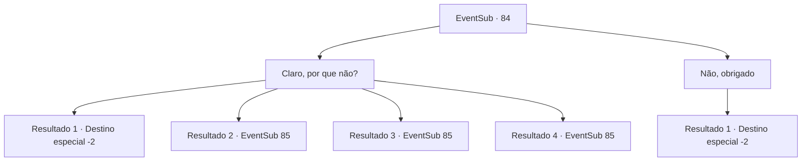

# Eventos secundários · 84

[Índice da tabela](index.md) · [Índice geral](../index.md)

ID: `pt:EventSub:84` · Fonte: `EventSub4` · Versão: 1.2.47.

Mapeamento estático dos arquivos; a disponibilidade e a execução dependem do estado da run.

## Texto do evento

*Sem texto no arquivo.*

## Dados de entrada

```json
{
  "id": 84,
  "grade": 1,
  "subEvent": "",
  "required": ""
}
```

## Mapa das escolhas



## Escolhas e resultados

### Escolha 1

Claro, por que não?

Requisitos e outros campos da escolha:

```json
{
  "required": ""
}
```

#### Resultado 1.1

Você concorda em competir contra ela por um desejo. Ela o destrói completamente com suas habilidades de pesca. Ela sorri um sorriso triunfante e começa a provocá -lo. 

 "Eu tenho tantos desejos! Mas vamos para casa primeiro."

 Ela pega a vara de pesca e uma rede cheia de peixe antes de pular de volta para casa. 

 Depois de voltar, ela pede que você limpe a casa. 

 "Meu desejo é que você limpe todo esse lugar. Vai!"

 Então ela pega um salmão da rede e começa a prepará -la. Você varre e esfrega o local limpo. Então vocês dois têm salmão juntos. Momentos depois, você volta e continua sua jornada.

Continuação registrada: [Destino especial `-2`](../destinos-especiais.md).

```json
{
  "required": "",
  "chance": "30",
  "nextEvent": -2,
  "type": 1,
  "reward": "0_0_1|5_92_4|14_0_5"
}
```

#### Resultado 1.2

Você concorda em competir contra ela por um desejo. Você consegue vencer por uma pequena margem. Ela te dá um tapinha no bumbum e te elogia. 

 "Impressionante, {1}! O que você quer? Vou fazer o meu melhor para realizar isso."


Continuação registrada: [Evento 85](0085.md) na mesma tabela.

```json
{
  "required": "",
  "chance": "20",
  "nextEvent": 85,
  "type": 0,
  "reward": "3_144_1"
}
```

#### Resultado 1.3

Você concorda em competir contra ela por um desejo. Você está ganhando por uma pequena margem, quando a vara de Majet se curva com o peso de algo enorme. Esse algo começa a arrastá-la em direção à água. 

 "Ajuda! Venha e me agarre!"

 Você a segura pela cintura. A criatura, ou seja lá o que for, quebra a vara de Majet com sua força bruta. Os dois voam para trás e caem no chão. Majet começa a rir, com as costas apoiadas em seu peito. 

 "Hahaha! Foi por pouco... Eu teria ganhado se tivesse pegado aquele. Mas não peguei, então o que você quer? Farei o meu melhor para realizar."


Continuação registrada: [Evento 85](0085.md) na mesma tabela.

```json
{
  "required": "",
  "chance": "15",
  "nextEvent": 85,
  "type": 0,
  "reward": "3_144_1"
}
```

#### Resultado 1.4

Você concorda em competir contra ela por um desejo. Você está ganhando por uma pequena margem, quando a vara de Majet se curva com o peso de algo enorme. Esse algo começa a arrastá-la em direção à água. 

 "Ajuda! Venha e me agarre!"

 Você segura a vara por trás das costas dela. Sua força é suficiente para puxá-la completamente. Sai um carpa incrivelmente gigante. 

 "Uau... nunca vi uma carpa tão grande! Eu não teria conseguido isso sem você, então vou realizar um desejo para você."


Continuação registrada: [Evento 85](0085.md) na mesma tabela.

```json
{
  "required": "",
  "chance": "1|0_5_1",
  "nextEvent": 85,
  "type": 0,
  "reward": "3_143_1"
}
```

### Escolha 2

Não, obrigado

Requisitos e outros campos da escolha:

```json
{
  "required": ""
}
```

#### Resultado 2.1

Você educadamente recusa a oferta dela. Ela parece decepcionada enquanto recolhe sua linha de pesca. 

 "Acho que já é o suficiente por hoje. Pegamos o suficiente para duas pessoas se banquetearem."

 Você aproveita o prato de salmão de Majet antes de continuar sua jornada.

Continuação registrada: [Destino especial `-2`](../destinos-especiais.md).

```json
{
  "required": "",
  "chance": "1",
  "nextEvent": -2,
  "type": 2,
  "reward": "0_0_1|5_92_4|14_0_6"
}
```

## Referências que chegam a este evento

- [Evento 83 · escolha 1 · resultado 1](0083.md#escolha-1)
- [Evento 83 · escolha 2 · resultado 1](0083.md#escolha-2)
