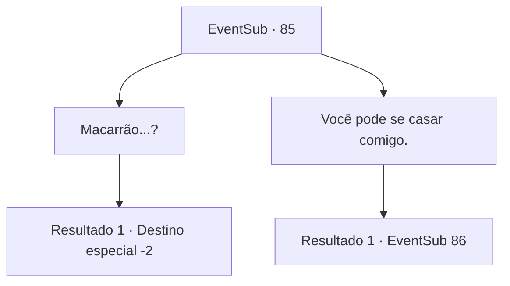

# Eventos secundários · 85

[Índice da tabela](index.md) · [Índice geral](../index.md)

ID: `pt:EventSub:85` · Fonte: `EventSub4` · Versão: 1.2.47.

Mapeamento estático dos arquivos; a disponibilidade e a execução dependem do estado da run.

## Texto do evento

*Sem texto no arquivo.*

## Dados de entrada

```json
{
  "id": 85,
  "grade": 1,
  "subEvent": "",
  "required": ""
}
```

## Mapa das escolhas



## Escolhas e resultados

### Escolha 1

Macarrão...?

Requisitos e outros campos da escolha:

```json
{
  "required": ""
}
```

#### Resultado 1.1

Ela sorri enquanto olha para você. 

 "Eu pensei assim. Você já pensou em mais alguma coisa?"

 Ela agarra você pelo pulso. <link=wave>

 "é melhor você estar pronto."

</link> Ela puxa você para dentro de casa. Vocês dois tem uma diversão intensa antes de se separarem.

Continuação registrada: [Destino especial `-2`](../destinos-especiais.md).

```json
{
  "required": "",
  "chance": "1",
  "nextEvent": -2,
  "type": 2,
  "reward": "0_0_1|0_1_1|5_92_4|14_0_5"
}
```

### Escolha 2

Você pode se casar comigo.

Requisitos e outros campos da escolha:

```json
{
  "required": "18_8_2|24_1_1"
}
```

#### Resultado 2.1

Majet ri alto. 

 "Hahaha! Que tipo de piada é essa? Você é melhor do que a maioria dos palhaços!"

 Ela ri até seu estômago doer. Então ela percebe o quão sério você parece e pergunta cuidadosamente. 

 "Você... está falando sério?"


Continuação registrada: [Evento 86](0086.md) na mesma tabela.

```json
{
  "required": "",
  "chance": "1",
  "nextEvent": 86,
  "type": 2,
  "reward": ""
}
```

## Referências que chegam a este evento

- [Evento 84 · escolha 1 · resultado 2](0084.md#escolha-1)
- [Evento 84 · escolha 1 · resultado 3](0084.md#escolha-1)
- [Evento 84 · escolha 1 · resultado 4](0084.md#escolha-1)
