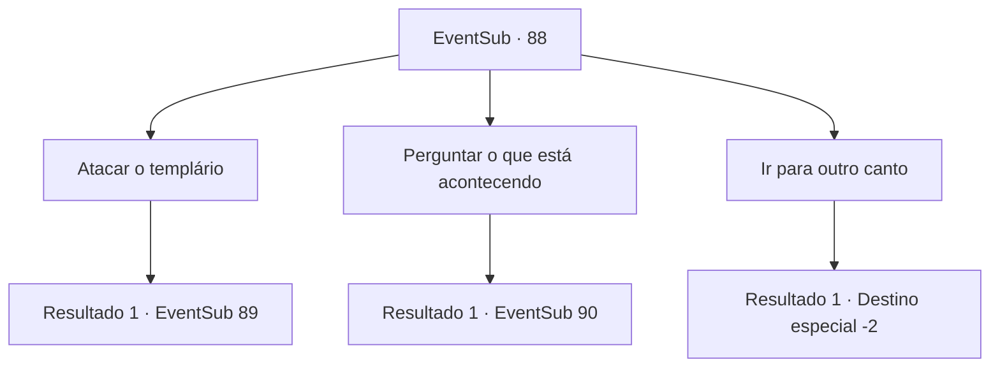

# Eventos secundários · 88

[Índice da tabela](index.md) · [Índice geral](../index.md)

ID: `pt:EventSub:88` · Fonte: `EventSub4` · Versão: 1.2.47.

Mapeamento estático dos arquivos; a disponibilidade e a execução dependem do estado da run.

## Texto do evento

Você decide parar em uma pequena cidade para reabastecer comida e descansar um pouco. De repente, um templário o interrompe em suas trilhas. A entrada da cidade é barricada e guardada por cavaleiros. Você ouve as pessoas gritarem e percebe uma fumaça preta subindo no céu. As chamas começam a consumir as casas. |drawing_burningCity| Templários vagam pelas ruas, lanças prontas, perfurando aqueles que conseguem escapar de suas casas.

## Dados de entrada

```json
{
  "id": 88,
  "grade": 1,
  "subEvent": "3",
  "required": "12_3_0"
}
```

## Mapa das escolhas



## Escolhas e resultados

### Escolha 1

Atacar o templário

Requisitos e outros campos da escolha:

```json
{
  "required": ""
}
```

#### Resultado 1.1

Você avança contra o templário com sua arma. Eles sacam suas lâminas em resposta.

Continuação registrada: [Evento 89](0089.md) na mesma tabela.

```json
{
  "required": "",
  "chance": "1",
  "nextEvent": 89,
  "type": 2,
  "reward": "6_0_50",
  "place": 13
}
```

### Escolha 2

Perguntar o que está acontecendo

Requisitos e outros campos da escolha:

```json
{
  "required": "5_96_0"
}
```

#### Resultado 2.1

Você pergunta o que está acontecendo. Um dos templários se aproxima de você. Ele tem um remendo no lado esquerdo do peito que diz 'Sênior Templário Silarang'. 

 "Uma praga mortal está à solta. Se não limparmos este lugar por fogo, não haverá mais nada deste país, mas de um monte de corpos. Já perdemos cinco outras cidades. Aconselhamos que você fique o mais longe possível deste lugar."

 Nesse momento, uma mulher segurando um bebê sai correndo das chamas e começa a implorar. <link=shake> 

 "por favor, pelo menos salve meu filho!"

 </link> Os Templários a esfaqueam imediatamente, e o bebê cai. Ele rola em direção ao pé de Silarang. Ele olha para o filho gritando e puxa sua lâmina.

Continuação registrada: [Evento 90](0090.md) na mesma tabela.

```json
{
  "required": "",
  "chance": "1",
  "nextEvent": 90,
  "type": 2,
  "reward": ""
}
```

### Escolha 3

Ir para outro canto

Requisitos e outros campos da escolha:

```json
{
  "required": ""
}
```

#### Resultado 3.1

Você deixa a cidade em chamas para trás e continua em frente.

Continuação registrada: [Destino especial `-2`](../destinos-especiais.md).

```json
{
  "required": "",
  "chance": "1",
  "nextEvent": -2,
  "type": 2,
  "reward": "0_2_1|12_3_-1"
}
```

## Referências que chegam a este evento

Nenhum `nextEvent` positivo da mesma tabela aponta para este nó. Isso não prova que seja inacessível: sorteio e estado de história podem selecioná-lo.

