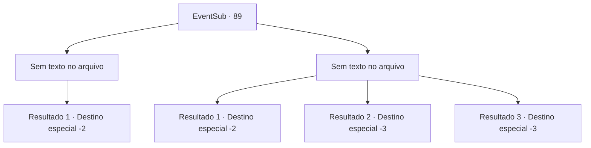

# Eventos secundários · 89

[Índice da tabela](index.md) · [Índice geral](../index.md)

ID: `pt:EventSub:89` · Fonte: `EventSub4` · Versão: 1.2.47.

Mapeamento estático dos arquivos; a disponibilidade e a execução dependem do estado da run.

## Texto do evento

*Sem texto no arquivo.*

## Dados de entrada

```json
{
  "id": 89,
  "grade": 1,
  "subEvent": "3",
  "required": ""
}
```

## Mapa das escolhas



## Escolhas e resultados

### Escolha 1

*Sem texto no arquivo; o papel dessa opção depende da interface do jogo.*

Requisitos e outros campos da escolha:

```json
{
  "required": ""
}
```

#### Resultado 1.1

Você derrota os templários e rompe a barricada deles. Alguns sobreviventes se dispersam de dentro. Uma mulher chorosa segurando uma criança expressa sua gratidão. 

 "Obrigado, aventureiro! Você nos salvou!"

 Ela enxuga as lágrimas com as mãos cobertas de fuligem e lhe entrega algumas moedas de ouro. Então ela corre junto com os outros. Você deixa para trás a cidade em chamas e os corpos dos templários enquanto continua sua jornada.

Continuação registrada: [Destino especial `-2`](../destinos-especiais.md).

```json
{
  "required": "",
  "chance": "1",
  "nextEvent": -2,
  "type": 2,
  "reward": "0_3_5|0_4_5|12_3_3|0_2_1"
}
```

### Escolha 2

*Sem texto no arquivo; o papel dessa opção depende da interface do jogo.*

Requisitos e outros campos da escolha:

```json
{
  "required": ""
}
```

#### Resultado 2.1

Tentas atacar o templário, mas acabas por te ferir a ti mesmo. Eles não te perseguem enquanto foges, e em vez disso vão atrás dos residentes que conseguiram escapar.

Continuação registrada: [Destino especial `-2`](../destinos-especiais.md).

```json
{
  "required": "1_0_2|1_1_2",
  "chance": "1",
  "nextEvent": -2,
  "type": 2,
  "reward": "0_0_-1|0_1_-1|12_3_-1|0_2_1"
}
```

#### Resultado 2.2

As lâminas dos templários tiram a sua vida.

Continuação registrada: [Destino especial `-3`](../destinos-especiais.md).

```json
{
  "required": "2_0_2",
  "chance": "1",
  "nextEvent": -3,
  "type": 2,
  "reward": "0_0_-1|0_1_-1"
}
```

#### Resultado 2.3

As lâminas dos templários tiram a sua vida.

Continuação registrada: [Destino especial `-3`](../destinos-especiais.md).

```json
{
  "required": "2_1_2",
  "chance": "1",
  "nextEvent": -3,
  "type": 2,
  "reward": "0_0_-1|0_1_-1"
}
```

## Referências que chegam a este evento

- [Evento 88 · escolha 1 · resultado 1](0088.md#escolha-1)
