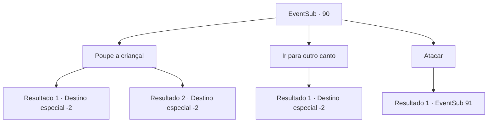

# Eventos secundários · 90

[Índice da tabela](index.md) · [Índice geral](../index.md)

ID: `pt:EventSub:90` · Fonte: `EventSub4` · Versão: 1.2.47.

Mapeamento estático dos arquivos; a disponibilidade e a execução dependem do estado da run.

## Texto do evento

*Sem texto no arquivo.*

## Dados de entrada

```json
{
  "id": 90,
  "grade": 1,
  "subEvent": "3",
  "required": ""
}
```

## Mapa das escolhas



## Escolhas e resultados

### Escolha 1

Poupe a criança!

Requisitos e outros campos da escolha:

```json
{
  "required": "1_7_9"
}
```

#### Resultado 1.1

Apesar de toda a sua persuasão, Silarang levanta sua espada sombriamente. 

 "Fui ordenado a livrar este lugar de todas as criaturas infectadas. Não farei...nenhuma exceção."

 Sua lâmina desce, e a criança para de gritar. Ele fica ali, encarando o chão por um tempo, antes de murmurar com uma voz depressiva. 

 "Inferno...o inferno me espera no meu fim."

 Então ele tropeça em sua tenda. Você fica olhando para o acampamento por um tempo antes de continuar sua jornada.

Continuação registrada: [Destino especial `-2`](../destinos-especiais.md).

```json
{
  "required": "",
  "chance": "11",
  "nextEvent": -2,
  "type": 2,
  "reward": "0_2_1|12_3_2|5_114_1"
}
```

#### Resultado 1.2

Você persuade com sucesso Silarang, e ele abaixa sua lâmina. Então ele pega a criança e entrega para outro templário. 

 "Se esta já está doente... ela morrerá em breve de qualquer maneira. Coloque a criança em quarentena e cuide dela. Se ela sobreviver por mais de duas semanas, então envie-a para o orfanato mais próximo."

 Então ele olha para você e de volta para a cidade em chamas. Os gritos desapareceram, e tudo o que se ouve é o som das chamas crepitantes. Você deixa a cidade em chamas para trás e continua em frente.

Continuação registrada: [Destino especial `-2`](../destinos-especiais.md).

```json
{
  "required": "",
  "chance": "1|0_12_1",
  "nextEvent": -2,
  "type": 2,
  "reward": "0_2_1|12_3_1|0_3_5"
}
```

### Escolha 2

Ir para outro canto

Requisitos e outros campos da escolha:

```json
{
  "required": ""
}
```

#### Resultado 2.1

Você fecha os olhos e se afasta. A criança para de gritar. Você ouve Silarang jogar sua lâmina no chão. Ele murmura entre dentes. 

 "Inferno... o inferno me espera no meu fim."

 Você deixa a cidade em chamas para trás e continua em frente.

Continuação registrada: [Destino especial `-2`](../destinos-especiais.md).

```json
{
  "required": "",
  "chance": "1",
  "nextEvent": -2,
  "type": 2,
  "reward": "0_2_1|12_3_2"
}
```

### Escolha 3

Atacar

Requisitos e outros campos da escolha:

```json
{
  "required": ""
}
```

#### Resultado 3.1

Você não pode ficar parado enquanto ele assassina uma criança inocente. Você avança em direção a Silarang com sua arma. Ele bloqueia seu golpe com um escudo e saca sua espada. Os outros templários se juntam a ele e começam a atacar você com suas lanças.

Continuação registrada: [Evento 91](0091.md) na mesma tabela.

```json
{
  "required": "",
  "chance": "1",
  "nextEvent": 91,
  "type": 2,
  "reward": "6_3_50",
  "place": 13
}
```

## Referências que chegam a este evento

- [Evento 88 · escolha 2 · resultado 1](0088.md#escolha-2)
