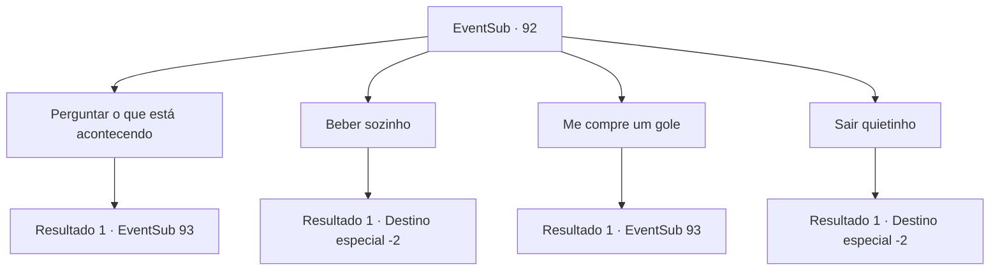

# Eventos secundários · 92

[Índice da tabela](index.md) · [Índice geral](../index.md)

ID: `pt:EventSub:92` · Fonte: `EventSub4` · Versão: 1.2.47.

Mapeamento estático dos arquivos; a disponibilidade e a execução dependem do estado da run.

## Texto do evento

Você se depara com um pub decadente na periferia. A mulher no comando parece estar na quina. Há um templário sentado no canto para onde ela está olhando. Você o reconhece como o templário sênior de antes, Galgano Silarang.

## Dados de entrada

```json
{
  "id": 92,
  "grade": 1,
  "subEvent": "3",
  "required": "12_3_2|1_2_20"
}
```

## Mapa das escolhas



## Escolhas e resultados

### Escolha 1

Perguntar o que está acontecendo

Requisitos e outros campos da escolha:

```json
{
  "required": ""
}
```

#### Resultado 1.1

Você se aproxima de Galgano e pergunta o que está acontecendo. Ele te encara e depois olha para o chão. 

 "Oh...é você de novo..."

 Ele esvazia seu copo e o bate na mesa, o que faz a mulher pular de surpresa. Ele a ignora e continua. 

 "Estou perdido. Os valores nos quais acreditei, o caminho que segui...não parecem tão corretos como eu pensava."

 Ele parece estar falando sobre o bebê que ele matou da última vez.

Continuação registrada: [Evento 93](0093.md) na mesma tabela.

```json
{
  "required": "",
  "chance": "1",
  "nextEvent": 93,
  "type": 2,
  "reward": "0_3_2"
}
```

### Escolha 2

Beber sozinho

Requisitos e outros campos da escolha:

```json
{
  "required": "1_4_1"
}
```

#### Resultado 2.1

Você olha para ele e senta-se longe dele. Ele bebe sua bebida e pede silenciosamente por outro copo. Ele ainda está bebendo quando você sai. Você o deixa para trás e continua.

Continuação registrada: [Destino especial `-2`](../destinos-especiais.md).

```json
{
  "required": "",
  "chance": "1",
  "nextEvent": -2,
  "type": 2,
  "reward": "0_4_-1|14_3_1|12_3_-1|0_2_1|14_3_0"
}
```

### Escolha 3

Me compre um gole

Requisitos e outros campos da escolha:

```json
{
  "required": ""
}
```

#### Resultado 3.1

Você senta em frente a Galgano e pede a ele uma bebida. Ele te encara vazia antes de abaixar o olhar de volta para o chão. 

 "Ah...é você de novo..."

 Ele esvazia seu copo e o bate na mesa, fazendo a mulher pular de surpresa. Relutantemente, ela coloca outro copo de cerveja na mesa para você. Galgano vê isso e continua. 

 "Estou perdido. Os valores nos quais acreditei, o caminho que segui...não parecem tão corretos como eu pensava."

 Você o escuta enquanto bebe cerveja gelada. Ele parece estar falando sobre o bebê que ele matou da última vez.

Continuação registrada: [Evento 93](0093.md) na mesma tabela.

```json
{
  "required": "",
  "chance": "1",
  "nextEvent": 93,
  "type": 2,
  "reward": "0_1_1|0_3_-1"
}
```

### Escolha 4

Sair quietinho

Requisitos e outros campos da escolha:

```json
{
  "required": ""
}
```

#### Resultado 4.1

Você deixa o templário sênior exausto para trás e sai. Ele bebe sem se importar com o que está ao seu redor. Você ouve a senhora suspirar enquanto sai.

Continuação registrada: [Destino especial `-2`](../destinos-especiais.md).

```json
{
  "required": "",
  "chance": "1",
  "nextEvent": -2,
  "type": 2,
  "reward": "14_3_1|12_3_-1|14_3_0"
}
```

## Referências que chegam a este evento

Nenhum `nextEvent` positivo da mesma tabela aponta para este nó. Isso não prova que seja inacessível: sorteio e estado de história podem selecioná-lo.

