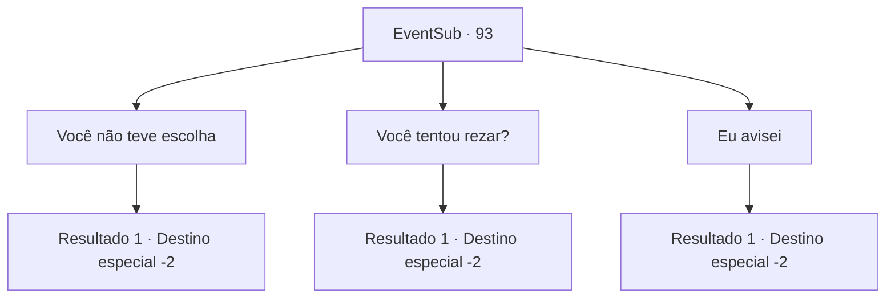

# Eventos secundários · 93

[Índice da tabela](index.md) · [Índice geral](../index.md)

ID: `pt:EventSub:93` · Fonte: `EventSub4` · Versão: 1.2.47.

Mapeamento estático dos arquivos; a disponibilidade e a execução dependem do estado da run.

## Texto do evento

*Sem texto no arquivo.*

## Dados de entrada

```json
{
  "id": 93,
  "grade": 1,
  "subEvent": "3",
  "required": ""
}
```

## Mapa das escolhas



## Escolhas e resultados

### Escolha 1

Você não teve escolha

Requisitos e outros campos da escolha:

```json
{
  "required": ""
}
```

#### Resultado 1.1

Tentas confortá-lo. 

 "Pffft.."

 Um sopro cínico de vento escapa entre os seus lábios. Ele bebe mais um copo e bate-o ainda mais forte na mesa. A senhora perde a paciência. 

 "Em breve vais começar a partir todas as minhas chávenas, senhor templário! Por que não vais perguntar pessoalmente em vez de ficares aqui a beber até ficares estúpido?"

 Galgano concorda e levanta-se lentamente. 

 "Ótima ideia. Devo fazê-lo."

 Ele sai cambaleando do pub.

Continuação registrada: [Destino especial `-2`](../destinos-especiais.md).

```json
{
  "required": "",
  "chance": "1",
  "nextEvent": -2,
  "type": 2,
  "reward": "12_3_4"
}
```

### Escolha 2

Você tentou rezar?

Requisitos e outros campos da escolha:

```json
{
  "required": ""
}
```

#### Resultado 2.1

Você sugere que ele comece a rezar. Ele concorda e levanta-se lentamente. 

 "Ótima ideia. O Senhor certamente ouvirá meus problemas..."

 Então ele sai cambaleando do pub.

Continuação registrada: [Destino especial `-2`](../destinos-especiais.md).

```json
{
  "required": "",
  "chance": "1",
  "nextEvent": -2,
  "type": 2,
  "reward": "12_3_4"
}
```

### Escolha 3

Eu avisei

Requisitos e outros campos da escolha:

```json
{
  "required": "5_114_1"
}
```

#### Resultado 3.1

Ele termina sua bebida e pede silenciosamente por outro copo. A senhora, preocupada, traz-lhe uma nova bebida e ele a engole quase imediatamente. Você o deixa para trás e continua.

Continuação registrada: [Destino especial `-2`](../destinos-especiais.md).

```json
{
  "required": "",
  "chance": "1",
  "nextEvent": -2,
  "type": 2,
  "reward": "14_3_1|12_3_-1|14_3_0"
}
```

## Referências que chegam a este evento

- [Evento 92 · escolha 1 · resultado 1](0092.md#escolha-1)
- [Evento 92 · escolha 3 · resultado 1](0092.md#escolha-3)
