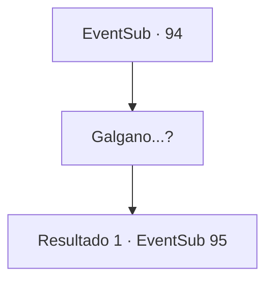

# Eventos secundários · 94

[Índice da tabela](index.md) · [Índice geral](../index.md)

ID: `pt:EventSub:94` · Fonte: `EventSub4` · Versão: 1.2.47.

Mapeamento estático dos arquivos; a disponibilidade e a execução dependem do estado da run.

## Texto do evento

Em um dia ensolarado e sem nuvens, você chega à cidade sagrada de St. Hillie. |drawing_saintheali| É bem conhecida pela torre imponente de sua catedral. Você decide ir dar uma olhada nela. O majestoso edifício de mármore é coberto de ouro e pedras preciosas. Você está hipnotizado. Então você encontra um conhecido.

## Dados de entrada

```json
{
  "id": 94,
  "grade": 1,
  "subEvent": "3",
  "required": "12_3_4"
}
```

## Mapa das escolhas



## Escolhas e resultados

### Escolha 1

Galgano...?

Requisitos e outros campos da escolha:

```json
{
  "required": ""
}
```

#### Resultado 1.1

Você mal o reconhece através de sua barba desgrenhada e cabelos longos. Ele também te vê. Ele parece ainda pior do que da última vez. Você tenta falar com ele, mas ele volta para suas orações. De repente, um velho padre vem falar com você. 

 "Você tem um momento?"

 Ele sussurra em seu ouvido. 

 "Por favor, suba na torre e faça um buraco no canto superior direito para mim."


Continuação registrada: [Evento 95](0095.md) na mesma tabela.

```json
{
  "required": "",
  "chance": "1",
  "nextEvent": 95,
  "type": 2,
  "reward": ""
}
```

## Referências que chegam a este evento

Nenhum `nextEvent` positivo da mesma tabela aponta para este nó. Isso não prova que seja inacessível: sorteio e estado de história podem selecioná-lo.

