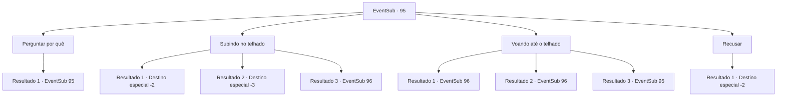

# Eventos secundários · 95

[Índice da tabela](index.md) · [Índice geral](../index.md)

ID: `pt:EventSub:95` · Fonte: `EventSub4` · Versão: 1.2.47.

Mapeamento estático dos arquivos; a disponibilidade e a execução dependem do estado da run.

## Texto do evento

*Sem texto no arquivo.*

## Dados de entrada

```json
{
  "id": 95,
  "grade": 1,
  "subEvent": "3",
  "required": ""
}
```

## Mapa das escolhas



## Escolhas e resultados

### Escolha 1

Perguntar por quê

Requisitos e outros campos da escolha:

```json
{
  "required": "5_101_0"
}
```

#### Resultado 1.1

Você pergunta ao padre por que você deveria fazer isso. Ele sussurra em uma voz ainda mais baixa. 

 "Esse homem tem rezado por dias sem comer. Mas ele não ouviu nada do Senhor. Ele vai perecer, a menos que... apresentemos a ele um milagre."


Continuação registrada: [Evento 95](0095.md) na mesma tabela.

```json
{
  "required": "",
  "chance": "1",
  "nextEvent": 95,
  "type": 2,
  "reward": "5_101_1"
}
```

### Escolha 2

Subindo no telhado

Requisitos e outros campos da escolha:

```json
{
  "required": ""
}
```

#### Resultado 2.1

O padre o guia a escalar o teto da catedral. É escorregadio da chuva da noite passada. Você começa a escorregar após as primeiras etapas. 
<link=shake> frast! </link>
 Você colide contra uma das esculturas de pedra na parede externa antes de cair no chão. Você geme de dor agonizante. O padre aparece, alarmado e chateado. 

 "Oh querido ... você está bem? Desculpe, eu não deveria ter perguntado."

 Ele entrega algumas moedas velhas e volta para dentro.

Continuação registrada: [Destino especial `-2`](../destinos-especiais.md).

```json
{
  "required": "1_0_2",
  "chance": "14",
  "nextEvent": -2,
  "type": 1,
  "reward": "0_0_-1|0_4_15|12_3_-1|0_2_1"
}
```

#### Resultado 2.2

O padre o guia a escalar o teto da catedral. É escorregadio da chuva da noite passada. Você começa a escorregar após as primeiras etapas. 
<link=shake> frast! </link>
 Você colide contra uma das esculturas de pedra na parede externa antes de cair no chão. Uma dor agonizante entra em ação quando sua mente começa a desaparecer na escuridão.

Continuação registrada: [Destino especial `-3`](../destinos-especiais.md).

```json
{
  "required": "2_0_2",
  "chance": "14",
  "nextEvent": -3,
  "type": 1,
  "reward": "0_0_-1"
}
```

#### Resultado 2.3

O padre o guia a escalar o teto da catedral. É escorregadio da chuva da noite passada. Mas seu corpo é notavelmente equilibrado e você consegue avançar sem escorregar. Depois de uma longa e perigosa caminhada, você chega ao topo da torre e dá um soco em um buraco onde o padre pediu. |drawing_prayPaladin| A luz do sol entra. Silarang para de orar e olha de braços abertos. 

 "Pai, pai! Mostre -me a verdade!"

 Só então, uma voz o responde. 

 "Eu entendo sua culpa, alma perdida. Vou lhe dar uma nova vida, uma vida de um escudo em vez de uma espada!"

 Galgano está em lágrimas enquanto retira sua espada. Então ele o esfaqueia no chão da catedral. O mármore cede como geléia enquanto a lâmina mergulha através dela.

Continuação registrada: [Evento 96](0096.md) na mesma tabela.

```json
{
  "required": "",
  "chance": "1|0_6_1",
  "nextEvent": 96,
  "type": 0,
  "reward": ""
}
```

### Escolha 3

Voando até o telhado

Requisitos e outros campos da escolha:

```json
{
  "required": "5_214_0"
}
```

#### Resultado 3.1

Você flutuou no ar e foi para o telhado que o padre lhe disse. Então você socou um buraco no telhado como ele perguntou. |drawing_prayPaladin| A luz do sol entra. Silarang para de orar e olha de braços abertos. 

 "Pai, pai! Mostre -me a verdade!"

 Só então, uma voz o responde. 

 "Eu entendo sua culpa, alma perdida. Vou lhe dar uma nova vida, uma vida de um escudo em vez de uma espada!"

 Galgano está em lágrimas enquanto retira sua espada. Então ele o esfaqueia no chão da catedral. O mármore cede como geléia enquanto a lâmina mergulha através dela.

Continuação registrada: [Evento 96](0096.md) na mesma tabela.

```json
{
  "required": "20_0_1",
  "chance": "1",
  "nextEvent": 96,
  "type": 2,
  "reward": ""
}
```

#### Resultado 3.2

Você flutuou no ar e foi para o telhado que o padre lhe disse. Então você socou um buraco no telhado como ele perguntou. |drawing_prayPaladin| A luz do sol entra. Silarang para de orar e olha de braços abertos. 

 "Pai, pai! Mostre -me a verdade!"

 Só então, uma voz o responde. 

 "Eu entendo sua culpa, alma perdida. Vou lhe dar uma nova vida, uma vida de um escudo em vez de uma espada!"

 Galgano está em lágrimas enquanto retira sua espada. Então ele o esfaqueia no chão da catedral. O mármore cede como geléia enquanto a lâmina mergulha através dela.

Continuação registrada: [Evento 96](0096.md) na mesma tabela.

```json
{
  "required": "20_10_1",
  "chance": "1",
  "nextEvent": 96,
  "type": 2,
  "reward": ""
}
```

#### Resultado 3.3

Você achou que seria bom voar até o telhado, mas não havia uma boa maneira.

Continuação registrada: [Evento 95](0095.md) na mesma tabela.

```json
{
  "required": "21_0_1|21_10_1",
  "chance": "1",
  "nextEvent": 95,
  "type": 2,
  "reward": "5_214_1"
}
```

### Escolha 4

Recusar

Requisitos e outros campos da escolha:

```json
{
  "required": ""
}
```

#### Resultado 4.1

Você recusa o pedido do velho padre. Ele solta um grunhido curto de decepção. Você deixa Galgano e o padre para trás e sai da catedral.

Continuação registrada: [Destino especial `-2`](../destinos-especiais.md).

```json
{
  "required": "",
  "chance": "1",
  "nextEvent": -2,
  "type": 2,
  "reward": "14_3_1|12_3_-1|14_3_0"
}
```

## Referências que chegam a este evento

- [Evento 94 · escolha 1 · resultado 1](0094.md#escolha-1)
- [Evento 95 · escolha 1 · resultado 1](0095.md#escolha-1)
- [Evento 95 · escolha 3 · resultado 3](0095.md#escolha-3)
