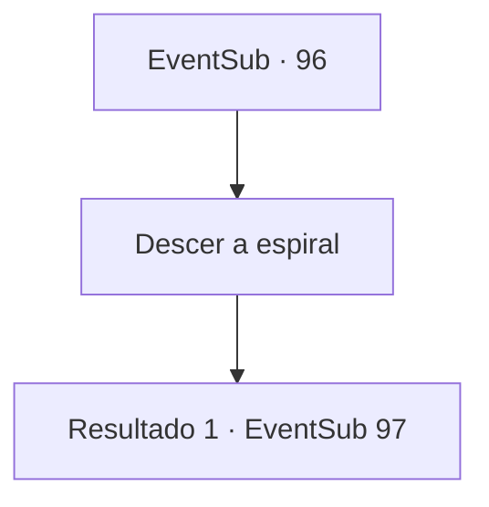

# Eventos secundários · 96

[Índice da tabela](index.md) · [Índice geral](../index.md)

ID: `pt:EventSub:96` · Fonte: `EventSub4` · Versão: 1.2.47.

Mapeamento estático dos arquivos; a disponibilidade e a execução dependem do estado da run.

## Texto do evento

*Sem texto no arquivo.*

## Dados de entrada

```json
{
  "id": 96,
  "grade": 1,
  "subEvent": "3",
  "required": ""
}
```

## Mapa das escolhas



## Escolhas e resultados

### Escolha 1

Descer a espiral

Requisitos e outros campos da escolha:

```json
{
  "required": ""
}
```

#### Resultado 1.1

Você desce da torre depois que Galgano sai da catedral. O padre está franzindo a testa para a espada no chão. 

 "Meu Deus, meu Deus... Este piso de mármore nos custou uma fortuna..."

 Ele olha para cima para você. Então ele acaricia sua barba enquanto pede um favor. 

 "Você poderia por favor puxar esta espada para nós? Você pode ficar com ela se quiser."


Continuação registrada: [Evento 97](0097.md) na mesma tabela.

```json
{
  "required": "",
  "chance": "1",
  "nextEvent": 97,
  "type": 2,
  "reward": ""
}
```

## Referências que chegam a este evento

- [Evento 95 · escolha 2 · resultado 3](0095.md#escolha-2)
- [Evento 95 · escolha 3 · resultado 1](0095.md#escolha-3)
- [Evento 95 · escolha 3 · resultado 2](0095.md#escolha-3)
