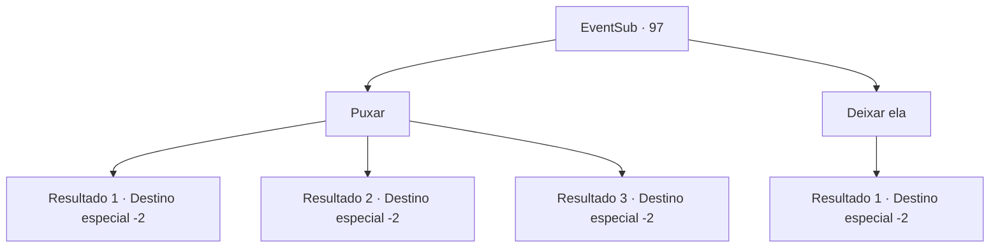

# Eventos secundários · 97

[Índice da tabela](index.md) · [Índice geral](../index.md)

ID: `pt:EventSub:97` · Fonte: `EventSub4` · Versão: 1.2.47.

Mapeamento estático dos arquivos; a disponibilidade e a execução dependem do estado da run.

## Texto do evento

*Sem texto no arquivo.*

## Dados de entrada

```json
{
  "id": 97,
  "grade": 1,
  "subEvent": "3",
  "required": ""
}
```

## Mapa das escolhas



## Escolhas e resultados

### Escolha 1

Puxar

Requisitos e outros campos da escolha:

```json
{
  "required": ""
}
```

#### Resultado 1.1

Você estende a mão para a espada, que parece bastante sagrada à luz do sol. A lâmina de Galgano desliza suavemente para fora da rocha, como se estivesse esperando por você o tempo todo. Os olhos do padre se arregalam. 

 "Eu pensei que seria um desafio... Mas parece que estava esperando por um novo dono. Obrigado pela ajuda. Preciso ir ver Galgano agora. E também chamar alguém para consertar o chão..."

 Ele sai da catedral com as mãos atrás das costas. Você pega a espada e continua sua jornada.

Continuação registrada: [Destino especial `-2`](../destinos-especiais.md).

```json
{
  "required": "1_3_20",
  "chance": "1",
  "nextEvent": -2,
  "type": 2,
  "reward": "0_2_3|3_77_1|12_3_-1|14_3_2"
}
```

#### Resultado 1.2

Você estende a mão para a espada, que parece bastante sagrada à luz do sol. Mas a lâmina de Galgano permanece firmemente presa no chão. Ela nem se move. Você reúne todas as suas forças e tenta puxá-la, mas é inútil. O padre suspira e te impede depois de um tempo. 

 "Acho que já chega... Não precisa desperdiçar todas as suas forças em uma espada. Mas obrigado por ajudar."

 Ele te entrega algumas moedas de ouro e sai da catedral. Você deixa a espada de Galgano para trás e continua sua jornada.

Continuação registrada: [Destino especial `-2`](../destinos-especiais.md).

```json
{
  "required": "2_3_20",
  "chance": "20",
  "nextEvent": -2,
  "type": 1,
  "reward": "0_2_3|0_4_50|12_3_-1|14_3_3"
}
```

#### Resultado 1.3

Você estende a mão para a espada, que parece bastante sagrada à luz do sol. Você reúne todas as suas forças e puxa a alça. Assim que suas mãos começam a ficar dormentes e sua cabeça começa a girar, a lâmina dispara do chão. Os olhos do padre se arregalam. 

 "Ah... Eu invejo sua juventude, aventureiro. Obrigado pela ajuda. Eu devo ir ver Galgano agora. E também chamar alguém para consertar o chão..."

 Ele sai da catedral com as mãos atrás das costas. Você pega a espada e continua sua jornada.

Continuação registrada: [Destino especial `-2`](../destinos-especiais.md).

```json
{
  "required": "2_3_20",
  "chance": "1|0_5_1",
  "nextEvent": -2,
  "type": 0,
  "reward": "0_2_3|3_77_1|12_3_-1|14_3_2"
}
```

### Escolha 2

Deixar ela

Requisitos e outros campos da escolha:

```json
{
  "required": ""
}
```

#### Resultado 2.1

Você recusa o pedido do velho padre. Ele solta um grunhido curto de decepção. Você deixa Galgano e o padre para trás e sai da catedral.

Continuação registrada: [Destino especial `-2`](../destinos-especiais.md).

```json
{
  "required": "",
  "chance": "1",
  "nextEvent": -2,
  "type": 2,
  "reward": "14_3_3|12_3_-1"
}
```

## Referências que chegam a este evento

- [Evento 96 · escolha 1 · resultado 1](0096.md#escolha-1)
