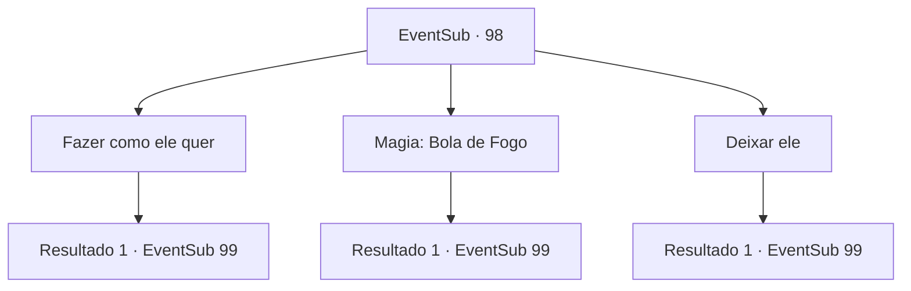

# Eventos secundários · 98

[Índice da tabela](index.md) · [Índice geral](../index.md)

ID: `pt:EventSub:98` · Fonte: `EventSub4` · Versão: 1.2.47.

Mapeamento estático dos arquivos; a disponibilidade e a execução dependem do estado da run.

## Texto do evento

Você decide parar em uma cidade montanhosa chamada Arhen. Mas o lugar não é o que você esperava. Suas ruas estão completamente vazias, exceto por cadáveres negros espalhados por toda parte. Ratos gordos mordiscam carne podre. |drawing_deadCity| Você cobre o nariz e a boca enquanto caminha entre os ratos. Nesse momento, uma voz fraca chama por você. 

 "Aventureiro..."

 O rosto do homem parece a morte, assim como suas mãos e pés enegrecidos. Tremendo, ele implora para você matá-lo.

## Dados de entrada

```json
{
  "id": 98,
  "grade": 1,
  "subEvent": "3",
  "required": "12_3_3"
}
```

## Mapa das escolhas



## Escolhas e resultados

### Escolha 1

Fazer como ele quer

Requisitos e outros campos da escolha:

```json
{
  "required": ""
}
```

#### Resultado 1.1

Você tira a dor dele com um golpe rápido. O sangue vermelho escuro respinga os paralelepípedos. 

 Depois de uma curta caminhada, você chega a uma igreja antiga. Um padre está gritando com uma voz aguda. 

 "Pessoas de Arhen! Este é o acerto de Deus de Deus! Nós pecamos e agora devemos orar por perdão!"

 Então ele vê você e se aproxima. 

 "Você deve ser um aventureiro. Você seria tão gentil a ponto de me dar uma mão? Todos nós precisamos orar juntos para apaziguar nosso pai no céu, Mas alguns estão se recusando a cooperar. Por favor me ajude a trazer à tona aqueles que ainda estão em casa."

 Uma velha de um olho interrompe o padre com um grito. 

 "Não é assim que isso funciona, você imbecil! Temos que ficar separados! Pare de falar bobagem e volte para casa!"


Continuação registrada: [Evento 99](0099.md) na mesma tabela.

```json
{
  "required": "",
  "chance": "1",
  "nextEvent": 99,
  "type": 2,
  "reward": "5_96_1"
}
```

### Escolha 2

Magia: Bola de Fogo

Requisitos e outros campos da escolha:

```json
{
  "required": "20_0_2|1_1_2"
}
```

#### Resultado 2.1

As chamas saem da ponta dos seus dedos. <link=shake><color=red>

 "GRYAAAAH!!!!"

</color></link> O homem agoniza e grita no fogo. Você não suporta vê-lo. Logo, ele para de se mover e tudo o que resta dele é uma pilha de cinzas. 

 Depois de uma curta caminhada, você chega a uma antiga igreja. Um padre está gritando em voz alta. 

 "Povo de Arhen! Este é o julgamento de Deus! Nós pecamos, e agora devemos orar por perdão!"

 Então ele vê você e se aproxima. 

 "Você deve ser um aventureiro. Você faria a gentileza de me dar uma mão? Todos nós precisamos orar juntos para apaziguar nosso Pai Celestial, mas alguns estão se recusando a cooperar. Por favor, ajude-me a trazer aqueles que ainda estão em casa."

 Uma velha caolha interrompe o padre com um grito. 

 "Não é assim que funciona, seu imbecil! Temos que ficar separados! Pare de falar besteira e volte para casa!"


Continuação registrada: [Evento 99](0099.md) na mesma tabela.

```json
{
  "required": "",
  "chance": "1",
  "nextEvent": 99,
  "type": 2,
  "reward": "0_2_1|0_1_-1|5_96_1"
}
```

### Escolha 3

Deixar ele

Requisitos e outros campos da escolha:

```json
{
  "required": ""
}
```

#### Resultado 3.1

Você ignora seus apelos desesperados e vai embora. 

 Depois de uma curta caminhada, você chega a uma antiga igreja. Um padre está gritando em voz alta. 

 "Povo de Arhen! Este é o julgamento de Deus! Nós pecamos, e agora devemos orar por perdão!"

 Então ele vê você e se aproxima. 

 "Você deve ser um aventureiro. Você faria a gentileza de me dar uma mão? Todos nós precisamos orar juntos para apaziguar nosso Pai Celestial, mas alguns estão se recusando a cooperar. Por favor, ajude-me a trazer aqueles que ainda estão em casa."

 Uma velha caolha interrompe o padre com um grito. 

 "Não é assim que funciona, seu imbecil! Temos que ficar separados! Pare de falar besteira e volte para casa!"


Continuação registrada: [Evento 99](0099.md) na mesma tabela.

```json
{
  "required": "",
  "chance": "1",
  "nextEvent": 99,
  "type": 2,
  "reward": "5_96_2"
}
```

## Referências que chegam a este evento

Nenhum `nextEvent` positivo da mesma tabela aponta para este nó. Isso não prova que seja inacessível: sorteio e estado de história podem selecioná-lo.

