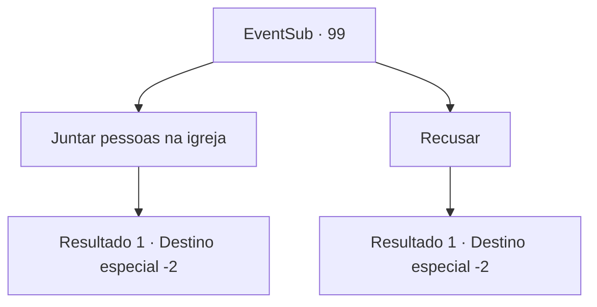

# Eventos secundários · 99

[Índice da tabela](index.md) · [Índice geral](../index.md)

ID: `pt:EventSub:99` · Fonte: `EventSub4` · Versão: 1.2.47.

Mapeamento estático dos arquivos; a disponibilidade e a execução dependem do estado da run.

## Texto do evento

*Sem texto no arquivo.*

## Dados de entrada

```json
{
  "id": 99,
  "grade": 1,
  "subEvent": "3",
  "required": ""
}
```

## Mapa das escolhas



## Escolhas e resultados

### Escolha 1

Juntar pessoas na igreja

Requisitos e outros campos da escolha:

```json
{
  "required": ""
}
```

#### Resultado 1.1

Você decide ajudar o padre e reunir sobreviventes na igreja. A velha amaldiçoa você. 

 "Vocês todos vão morrer... você está levando todos eles até a morte deles!"

 Então ela vira uma esquina e desaparece. Você vai de porta em porta, batendo em casas que soam povoadas. 

 Depois de um rápido passeio pela cidade, você consegue reunir uma multidão considerável. O padre segura suas mãos em gratidão. 

 "Obrigado por orientar todas essas pessoas ao caminho da salvação..!"

 Você pega o ouro que ele oferece e deixa a cidade amaldiçoada.

Continuação registrada: [Destino especial `-2`](../destinos-especiais.md).

```json
{
  "required": "",
  "chance": "1",
  "nextEvent": -2,
  "type": 2,
  "reward": "0_4_50|0_3_1|12_3_5|0_2_2"
}
```

### Escolha 2

Recusar

Requisitos e outros campos da escolha:

```json
{
  "required": ""
}
```

#### Resultado 2.1

Você ouve a mulher idosa e se recusa a reunir mais pessoas. Ele cruza os braços e olha fixamente para você. 

 "Hmph... Vamos ver o que Deus reserva para um espectador como você."

 Você deixa a cidade sombria e amaldiçoada para trás.

Continuação registrada: [Destino especial `-2`](../destinos-especiais.md).

```json
{
  "required": "",
  "chance": "1",
  "nextEvent": -2,
  "type": 2,
  "reward": "12_3_6"
}
```

## Referências que chegam a este evento

- [Evento 98 · escolha 1 · resultado 1](0098.md#escolha-1)
- [Evento 98 · escolha 2 · resultado 1](0098.md#escolha-2)
- [Evento 98 · escolha 3 · resultado 1](0098.md#escolha-3)
