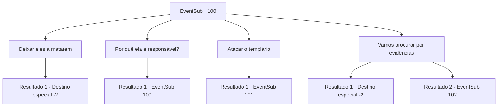

# Eventos secundários · 100

[Índice da tabela](index.md) · [Índice geral](../index.md)

ID: `pt:EventSub:100` · Fonte: `EventSub4` · Versão: 1.2.47.

Mapeamento estático dos arquivos; a disponibilidade e a execução dependem do estado da run.

## Texto do evento

Você cai na cidade atormentada de Arhen novamente. Não se encontra uma única alma, nem mesmo o padre e seus seguidores. É uma cidade fantasma. O vento uiva pelos prédios como se lamentasse os mortos. Você está perdido em pensamentos quando um grito perfura o ar. Um punhado de templários está perseguindo uma velha. Eles logo a alcançam e a amarram. Um deles dá-lhe uma sentença no local. 

 "Você está presa por iniciar a praga. Você será queimada após um curto julgamento."

 Ela tenta fugir, mas os cavaleiros a seguram com firmeza. 

 "Tire suas mãos de mim!"


## Dados de entrada

```json
{
  "id": 100,
  "grade": 1,
  "subEvent": "3",
  "required": "12_3_5"
}
```

## Mapa das escolhas



## Escolhas e resultados

### Escolha 1

Deixar eles a matarem

Requisitos e outros campos da escolha:

```json
{
  "required": ""
}
```

#### Resultado 1.1

Você deixa os templários fazerem o trabalho deles. A velha mulher chuta e grita enquanto eles a levam embora. Logo, a cidade fica quieta novamente. Você deixa a cidade vazia para trás e continua sua jornada.

Continuação registrada: [Destino especial `-2`](../destinos-especiais.md).

```json
{
  "required": "",
  "chance": "1",
  "nextEvent": -2,
  "type": 2,
  "reward": "0_3_-1|12_3_-1|14_3_4|0_2_1"
}
```

### Escolha 2

Por quê ela é responsável?

Requisitos e outros campos da escolha:

```json
{
  "required": "5_102_0"
}
```

#### Resultado 2.1

Você pergunta aos templários por que a velha é responsável pela praga. Um deles responde. 

 "Bem... você não consegue ver? Ela é a única que sobreviveu, enquanto todos os outros pereceram na praga. Ela deve estar por trás de tudo isso."


Continuação registrada: [Evento 100](0100.md) na mesma tabela.

```json
{
  "required": "",
  "chance": "1",
  "nextEvent": 100,
  "type": 2,
  "reward": "5_102_1"
}
```

### Escolha 3

Atacar o templário

Requisitos e outros campos da escolha:

```json
{
  "required": ""
}
```

#### Resultado 3.1

Você ataca um dos templários. Ele desvia do seu ataque e saca sua arma. 

 "Argh..! Ele está com ela!"


Continuação registrada: [Evento 101](0101.md) na mesma tabela.

```json
{
  "required": "",
  "chance": "1",
  "nextEvent": 101,
  "type": 2,
  "reward": "6_3_50",
  "place": 13
}
```

### Escolha 4

Vamos procurar por evidências

Requisitos e outros campos da escolha:

```json
{
  "required": "5_102_1"
}
```

#### Resultado 4.1

Tentas convencer os templários de que eles precisam de provas para provar a sua culpa. Mas és um orador terrível e eles recusam-se a ouvir-te. Eles prosseguem arrastando a velha mulher. Em breve, mal consegues ouvir os seus gritos. Deixas a cidade oca para trás e continuas a tua jornada.

Continuação registrada: [Destino especial `-2`](../destinos-especiais.md).

```json
{
  "required": "",
  "chance": "11",
  "nextEvent": -2,
  "type": 1,
  "reward": "12_3_-1|14_3_4|0_2_1"
}
```

#### Resultado 4.2

Tenta convencer os templários de que eles precisam de evidências para provar sua culpa. Eles não podem deixar de concordar com sua lógica impecável. 

 "Você faz um ponto convincente. Vamos adiar sua execução."

 Você entra na casa da velha. Um cheiro estranho irradia de dentro.

Continuação registrada: [Evento 102](0102.md) na mesma tabela.

```json
{
  "required": "",
  "chance": "1|0_7_1",
  "nextEvent": 102,
  "type": 0,
  "reward": ""
}
```

## Referências que chegam a este evento

- [Evento 100 · escolha 2 · resultado 1](0100.md#escolha-2)
