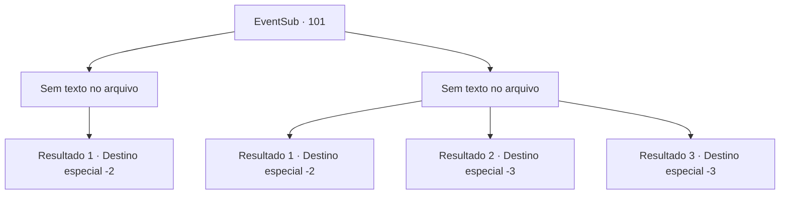

# Eventos secundários · 101

[Índice da tabela](index.md) · [Índice geral](../index.md)

ID: `pt:EventSub:101` · Fonte: `EventSub4` · Versão: 1.2.47.

Mapeamento estático dos arquivos; a disponibilidade e a execução dependem do estado da run.

## Texto do evento

*Sem texto no arquivo.*

## Dados de entrada

```json
{
  "id": 101,
  "grade": 1,
  "subEvent": "3",
  "required": ""
}
```

## Mapa das escolhas



## Escolhas e resultados

### Escolha 1

*Sem texto no arquivo; o papel dessa opção depende da interface do jogo.*

Requisitos e outros campos da escolha:

```json
{
  "required": ""
}
```

#### Resultado 1.1

Você derrota os templários e salva a velha mulher. Ela resmunga um pedido de desculpas bastante grosseiro. 

 "Eu não tenho muito tempo de vida mesmo... mas suponho que ainda devo agradecer. Siga-me."

 Ela bate algumas vezes em suas costas e entra em sua casa. Você a segue para dentro. Um cheiro estranho irradia de dentro, e você sente como se estivesse sendo observado. Você percebe que gatos estão te observando de diferentes cantos do quarto. A velha mulher tira algo de uma cesta e entrega para você. 

 "Aqui... eu costumava tocar isso de vez em quando. Pegue."

 Você pega sua velha flauta e volta para fora.

Continuação registrada: [Destino especial `-2`](../destinos-especiais.md).

```json
{
  "required": "",
  "chance": "1",
  "nextEvent": -2,
  "type": 2,
  "reward": "3_90_1|12_3_-1|14_3_5|0_2_3"
}
```

### Escolha 2

*Sem texto no arquivo; o papel dessa opção depende da interface do jogo.*

Requisitos e outros campos da escolha:

```json
{
  "required": ""
}
```

#### Resultado 2.1

Você não é páreo para os templários e mal consegue escapar. Eles não se incomodam em te perseguir. Você ouve o grito distante de dor da velha mulher.

Continuação registrada: [Destino especial `-2`](../destinos-especiais.md).

```json
{
  "required": "1_0_2|1_1_2",
  "chance": "1",
  "nextEvent": -2,
  "type": 2,
  "reward": "0_0_-1|0_1_-1|12_3_-1|14_3_4|0_2_1"
}
```

#### Resultado 2.2

A espada do templário tira a sua vida.

Continuação registrada: [Destino especial `-3`](../destinos-especiais.md).

```json
{
  "required": "2_0_2",
  "chance": "1",
  "nextEvent": -3,
  "type": 2,
  "reward": "0_0_-1|0_1_-1"
}
```

#### Resultado 2.3

A espada do templário tira a sua vida.

Continuação registrada: [Destino especial `-3`](../destinos-especiais.md).

```json
{
  "required": "2_1_2",
  "chance": "1",
  "nextEvent": -3,
  "type": 2,
  "reward": "0_0_-1|0_1_-1"
}
```

## Referências que chegam a este evento

- [Evento 100 · escolha 3 · resultado 1](0100.md#escolha-3)
- [Evento 105 · escolha 4 · resultado 1](0105.md#escolha-4)
