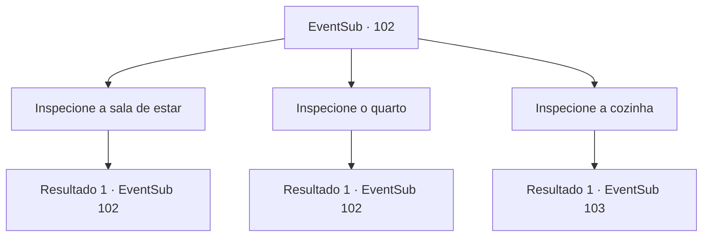

# Eventos secundários · 102

[Índice da tabela](index.md) · [Índice geral](../index.md)

ID: `pt:EventSub:102` · Fonte: `EventSub4` · Versão: 1.2.47.

Mapeamento estático dos arquivos; a disponibilidade e a execução dependem do estado da run.

## Texto do evento

*Sem texto no arquivo.*

## Dados de entrada

```json
{
  "id": 102,
  "grade": 1,
  "subEvent": "3",
  "required": ""
}
```

## Mapa das escolhas



## Escolhas e resultados

### Escolha 1

Inspecione a sala de estar

Requisitos e outros campos da escolha:

```json
{
  "required": "5_103_0"
}
```

#### Resultado 1.1

Sente-se como se estivesse sendo observado ao entrar na sala de estar. Percebe que os gatos estão te observando de diferentes cantos da sala. Um gato preto olha para cima enquanto alimenta seus filhotes, e um gato amarelo olha para você com condescendência de cima do armário. Você conta seis a sete gatos no total.

Continuação registrada: [Evento 102](0102.md) na mesma tabela.

```json
{
  "required": "",
  "chance": "1",
  "nextEvent": 102,
  "type": 2,
  "reward": "5_103_1"
}
```

### Escolha 2

Inspecione o quarto

Requisitos e outros campos da escolha:

```json
{
  "required": "5_103_1"
}
```

#### Resultado 2.1

Você entra no quarto enquanto os gatos continuam a te observar. Ele tem uma cama grande demais para uma senhora idosa. Você abre um armário de madeira que contém nada mais do que algumas roupas.

Continuação registrada: [Evento 102](0102.md) na mesma tabela.

```json
{
  "required": "",
  "chance": "1",
  "nextEvent": 102,
  "type": 2,
  "reward": "5_103_2"
}
```

### Escolha 3

Inspecione a cozinha

Requisitos e outros campos da escolha:

```json
{
  "required": "5_103_2"
}
```

#### Resultado 3.1

Você decide dar uma olhada na cozinha. Há um balde cheio de água com sabão, com pratos e outros utensílios de jantar dentro. Sacos de arroz e legumes ocupam as prateleiras na parede. Está muito limpa e organizada, considerando a condição da cidade. E ela mora com vários gatos. Você conclui que...

Continuação registrada: [Evento 103](0103.md) na mesma tabela.

```json
{
  "required": "",
  "chance": "1",
  "nextEvent": 103,
  "type": 2,
  "reward": "5_103_3"
}
```

## Referências que chegam a este evento

- [Evento 100 · escolha 4 · resultado 2](0100.md#escolha-4)
- [Evento 102 · escolha 1 · resultado 1](0102.md#escolha-1)
- [Evento 102 · escolha 2 · resultado 1](0102.md#escolha-2)
