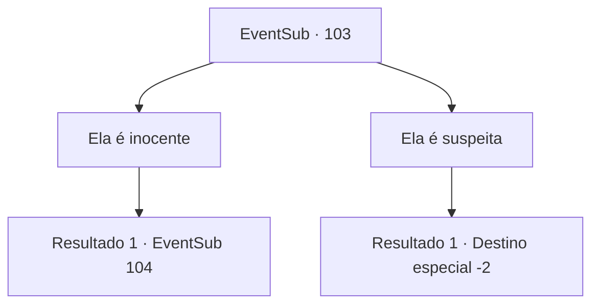

# Eventos secundários · 103

[Índice da tabela](index.md) · [Índice geral](../index.md)

ID: `pt:EventSub:103` · Fonte: `EventSub4` · Versão: 1.2.47.

Mapeamento estático dos arquivos; a disponibilidade e a execução dependem do estado da run.

## Texto do evento

*Sem texto no arquivo.*

## Dados de entrada

```json
{
  "id": 103,
  "grade": 1,
  "subEvent": "3",
  "required": ""
}
```

## Mapa das escolhas



## Escolhas e resultados

### Escolha 1

Ela é inocente

Requisitos e outros campos da escolha:

```json
{
  "required": ""
}
```

#### Resultado 1.1

A velha mulher não pode ser responsável pela praga de forma alguma. Não há nada em sua casa que esteja relacionado à doença, nem mesmo ferramentas para amaldiçoar. Os templários pensam por um momento antes de lhe perguntar. 

 "Então, por que ela nunca ficou doente?"


Continuação registrada: [Evento 104](0104.md) na mesma tabela.

```json
{
  "required": "",
  "chance": "1",
  "nextEvent": 104,
  "type": 2,
  "reward": ""
}
```

### Escolha 2

Ela é suspeita

Requisitos e outros campos da escolha:

```json
{
  "required": ""
}
```

#### Resultado 2.1

Você acha a velha mulher suspeita. Não ajuda o fato de ela viver com vários gatos. Os templários concordam com a cabeça. 

 "Eu sabia...! Amantes de gatos são quase certamente adoradores de demônios! Essa bruxa amaldiçoou toda a cidade!"

 Os templários agradecem e arrastam a velha mulher para longe.

Continuação registrada: [Destino especial `-2`](../destinos-especiais.md).

```json
{
  "required": "",
  "chance": "1",
  "nextEvent": -2,
  "type": 2,
  "reward": "0_7_-1|0_2_2|0_4_50|12_3_-1|14_3_4"
}
```

## Referências que chegam a este evento

- [Evento 102 · escolha 3 · resultado 1](0102.md#escolha-3)
