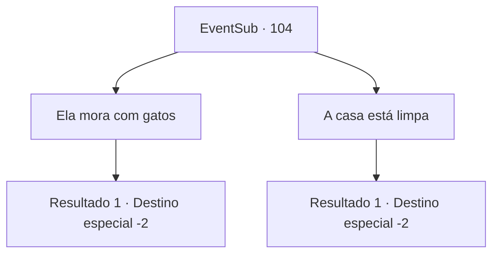

# Eventos secundários · 104

[Índice da tabela](index.md) · [Índice geral](../index.md)

ID: `pt:EventSub:104` · Fonte: `EventSub4` · Versão: 1.2.47.

Mapeamento estático dos arquivos; a disponibilidade e a execução dependem do estado da run.

## Texto do evento

*Sem texto no arquivo.*

## Dados de entrada

```json
{
  "id": 104,
  "grade": 1,
  "subEvent": "3",
  "required": ""
}
```

## Mapa das escolhas



## Escolhas e resultados

### Escolha 1

Ela mora com gatos

Requisitos e outros campos da escolha:

```json
{
  "required": ""
}
```

#### Resultado 1.1

Você diz a eles que viu vários gatos na casa da velha. Eles cruzam os braços e respondem de forma condescendente. 

 "Você realmente não sabe de nada, não é? Acumuladores de gatos geralmente são adoradores de demônios. Essa velha bruxa certamente amaldiçoou a todos. Já terminamos aqui, pare de nos incomodar e siga em frente."

 Os templários arrastam a velha mulher para longe.

Continuação registrada: [Destino especial `-2`](../destinos-especiais.md).

```json
{
  "required": "",
  "chance": "1",
  "nextEvent": -2,
  "type": 2,
  "reward": "0_2_2|12_3_-1|14_3_4"
}
```

### Escolha 2

A casa está limpa

Requisitos e outros campos da escolha:

```json
{
  "required": ""
}
```

#### Resultado 2.1

Você diz a eles que não encontrou nada relacionado à praga na casa, e a velha mulher mantém o lugar muito limpo. Eles parecem confusos, mas concordam parcialmente com a cabeça. 

 "Hmm...tudo bem. Vamos investigar como a limpeza está relacionada à praga. Enquanto isso, vamos adiar o julgamento dessa velha mulher."

 Os templários a libertam e vão embora. Ela resmunga um pedido de desculpas bastante rude. 

 "Eu não tenho muito tempo de vida mesmo... mas acho que ainda devo agradecer. Siga-me."

 Ela bate algumas vezes em suas costas e entra em sua casa. Você a segue para dentro. Um cheiro estranho irradia de dentro, e você sente como se estivesse sendo observado. Você percebe que gatos estão te observando de diferentes cantos do quarto. A velha mulher tira algo de uma cesta e entrega para você. 

 "Aqui... eu costumava tocar isso de vez em quando. Pegue."

 Você pega sua velha flauta e volta para fora.

Continuação registrada: [Destino especial `-2`](../destinos-especiais.md).

```json
{
  "required": "",
  "chance": "1",
  "nextEvent": -2,
  "type": 2,
  "reward": "3_90_1|12_3_-1|14_3_5|0_2_3"
}
```

## Referências que chegam a este evento

- [Evento 103 · escolha 1 · resultado 1](0103.md#escolha-1)
