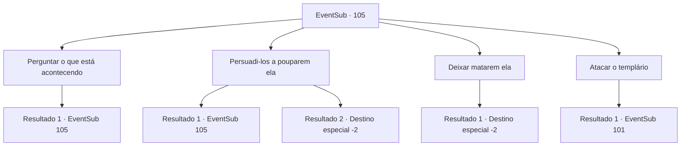

# Eventos secundários · 105

[Índice da tabela](index.md) · [Índice geral](../index.md)

ID: `pt:EventSub:105` · Fonte: `EventSub4` · Versão: 1.2.47.

Mapeamento estático dos arquivos; a disponibilidade e a execução dependem do estado da run.

## Texto do evento

Você cai na cidade atormentada de Arhen novamente. A doença morreu, mas suas ruas vazias mostram que o lugar ainda não se recuperou. Você está perdido em pensamentos quando um grito perfura o ar. Um punhado de templários está perseguindo uma velha. Eles logo a alcançam e a amarram. Seus gritos são ameaçadores. 

 "Obedeça, velha bruxa! Você está presa!"

 Ela tenta fugir, mas os cavaleiros a seguram com firmeza. 

 "Tire suas mãos de mim!"


## Dados de entrada

```json
{
  "id": 105,
  "grade": 1,
  "subEvent": "3",
  "required": "12_3_6"
}
```

## Mapa das escolhas



## Escolhas e resultados

### Escolha 1

Perguntar o que está acontecendo

Requisitos e outros campos da escolha:

```json
{
  "required": "5_104_0"
}
```

#### Resultado 1.1

Você pergunta aos templários o que está acontecendo. Um deles responde. 

 "O padre acusou essa velha mulher de blasfêmia. Uma inquisição ocorrerá e ela receberá a punição adequada."

 Por punição adequada, eles querem dizer uma das três opções: morte por enforcamento, queima ou decapitação.

Continuação registrada: [Evento 105](0105.md) na mesma tabela.

```json
{
  "required": "",
  "chance": "1",
  "nextEvent": 105,
  "type": 2,
  "reward": "5_104_1"
}
```

### Escolha 2

Persuadi-los a pouparem ela

Requisitos e outros campos da escolha:

```json
{
  "required": "5_104_1"
}
```

#### Resultado 2.1

Tentas convencê-los de que a velha mulher é inocente. Mas eles gritam de volta ferozmente. 

 "Inocente! Estás a dizer que o nosso padre é um mentiroso? Hmph. Vamos fingir que não ouvimos essa bobagem, agora segue em frente."


Continuação registrada: [Evento 105](0105.md) na mesma tabela.

```json
{
  "required": "",
  "chance": "11",
  "nextEvent": 105,
  "type": 1,
  "reward": "5_104_2"
}
```

#### Resultado 2.2

Você se lembra do que aconteceu entre a velha mulher e o padre. Então você explica logicamente aos templários como ela não cometeu blasfêmia. Eles acenam com a cabeça e respondem. 

 "Hmm... Bom ponto. Nosso padre pode ter se ofendido... mas ela não foi exatamente blasfema. Certo. Mas vamos ficar de olho nela apenas por precaução."

 Eles libertam a velha mulher e dão um passo para trás. Ela resmunga e entra em sua casa.

Continuação registrada: [Destino especial `-2`](../destinos-especiais.md).

```json
{
  "required": "",
  "chance": "1|0_7_1",
  "nextEvent": -2,
  "type": 0,
  "reward": "12_3_-1|14_3_6|0_2_2"
}
```

### Escolha 3

Deixar matarem ela

Requisitos e outros campos da escolha:

```json
{
  "required": ""
}
```

#### Resultado 3.1

Você deixa os templários fazerem o trabalho deles. A velha mulher chuta e grita enquanto eles a levam embora. Logo, a cidade fica quieta novamente. Você deixa a cidade vazia para trás e continua sua jornada.

Continuação registrada: [Destino especial `-2`](../destinos-especiais.md).

```json
{
  "required": "",
  "chance": "1",
  "nextEvent": -2,
  "type": 2,
  "reward": "0_3_-1|12_3_-1|14_3_4|0_2_1"
}
```

### Escolha 4

Atacar o templário

Requisitos e outros campos da escolha:

```json
{
  "required": ""
}
```

#### Resultado 4.1

Você ataca um dos templários. Ele desvia do seu ataque e saca sua arma. 

 "Argh..! Ele está com ela!"


Continuação registrada: [Evento 101](0101.md) na mesma tabela.

```json
{
  "required": "",
  "chance": "1",
  "nextEvent": 101,
  "type": 2,
  "reward": "6_3_50",
  "place": 13
}
```

## Referências que chegam a este evento

- [Evento 105 · escolha 1 · resultado 1](0105.md#escolha-1)
- [Evento 105 · escolha 2 · resultado 1](0105.md#escolha-2)
