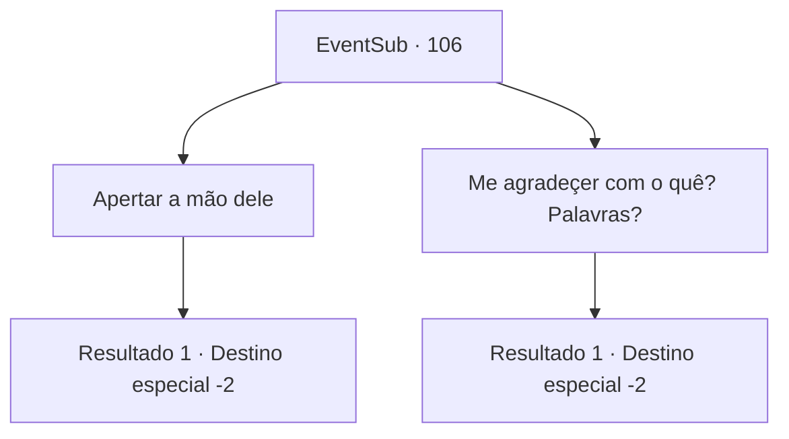

# Eventos secundários · 106

[Índice da tabela](index.md) · [Índice geral](../index.md)

ID: `pt:EventSub:106` · Fonte: `EventSub4` · Versão: 1.2.47.

Mapeamento estático dos arquivos; a disponibilidade e a execução dependem do estado da run.

## Texto do evento

|drawing_farmVillage| Você está em um orfanato localizado nos arredores de uma vila rural chamada Delua, quando você se depara com o Templário Sênior Galgano Silarang. Ele está falando com a freira encarregada do orfanato, mas então ele te vê e te cumprimenta como um velho amigo. 

 "Bem-vindo. Deixe-me apresentar-me adequadamente. Eu sou Galgano Silarang, templário sênior da Ordem da Raiz. Eu sempre quis agradecer a você, então é bom vê-lo novamente."

 Ele estende a mão para um aperto de mão.

## Dados de entrada

```json
{
  "id": 106,
  "grade": 1,
  "subEvent": "3",
  "required": "12_3_1"
}
```

## Mapa das escolhas



## Escolhas e resultados

### Escolha 1

Apertar a mão dele

Requisitos e outros campos da escolha:

```json
{
  "required": ""
}
```

#### Resultado 1.1

Você estende a mão e aperta a dele. A freira interrompe por trás. 

 "Templário sênior, qual é o nome da criança?"

 Ela segura um bebê nos braços, o bebê que você persuadiu Galgano a poupar. Galgano franze um pouco a testa antes de responder. 

 "Você salvou essa criança... Vou chamá-la de {1}, em sua homenagem."

 Então ele lhe entrega uma bolsa de ouro como símbolo de sua gratidão. A freira e o templário se despedem de você e voltam para dentro do orfanato.

Continuação registrada: [Destino especial `-2`](../destinos-especiais.md).

```json
{
  "required": "",
  "chance": "1",
  "nextEvent": -2,
  "type": 2,
  "reward": "0_4_10|12_3_7|0_2_1"
}
```

### Escolha 2

Me agradeçer com o quê? Palavras?

Requisitos e outros campos da escolha:

```json
{
  "required": ""
}
```

#### Resultado 2.1

Você se apresenta também, mas não aperta a mão dele. Enquanto você reclama, Galgano retira a mão e coça a parte de trás da cabeça. Então ele tira uma pequena bolsa de ouro e entrega para você. 

 "Haha, você está certo. Aqui está meu sinal de gratidão."

 A freira interrompe por trás. 

 "Senhor templário, qual é o nome da criança?"

 Ela segura um bebê nos braços, o bebê que você persuadiu Galgano a poupar. Galgano franze um pouco a testa antes de responder. 

 "Hmm... Vou chamá-lo de {1}, em sua homenagem."

 A freira e o templário se despedem de você e voltam para dentro do orfanato.

Continuação registrada: [Destino especial `-2`](../destinos-especiais.md).

```json
{
  "required": "",
  "chance": "1",
  "nextEvent": -2,
  "type": 2,
  "reward": "0_4_10|12_3_7|0_2_1"
}
```

## Referências que chegam a este evento

Nenhum `nextEvent` positivo da mesma tabela aponta para este nó. Isso não prova que seja inacessível: sorteio e estado de história podem selecioná-lo.

