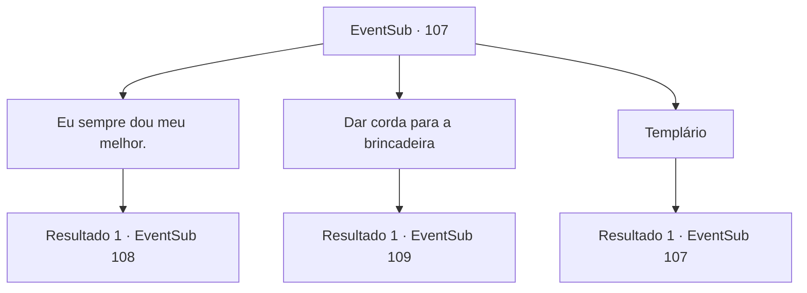

# Eventos secundários · 107

[Índice da tabela](index.md) · [Índice geral](../index.md)

ID: `pt:EventSub:107` · Fonte: `EventSub4` · Versão: 1.2.47.

Mapeamento estático dos arquivos; a disponibilidade e a execução dependem do estado da run.

## Texto do evento

|drawing_farmVillage| Você passa pela vila rural de Delua algum tempo depois. Uma criança pequena de repente para você e grita. 

 "Saque sua espada, seu demônio! Como templário sênior da ordem, vou mandá-lo de volta para o inferno!"


## Dados de entrada

```json
{
  "id": 107,
  "grade": 1,
  "subEvent": "3",
  "required": "12_3_7|1_2_40"
}
```

## Mapa das escolhas



## Escolhas e resultados

### Escolha 1

Eu sempre dou meu melhor.

Requisitos e outros campos da escolha:

```json
{
  "required": ""
}
```

#### Resultado 1.1

Você dá tudo o que tem em uma batalha um contra um para a criança. Logo, a criança cambaleia e cai no chão. Chorando e com os olhos vermelhos, ele olha para cima para você com admiração frustrada. 

 "Eu-eu perdi... Eu queria ser mais forte!"


Continuação registrada: [Evento 108](0108.md) na mesma tabela.

```json
{
  "required": "",
  "chance": "1",
  "nextEvent": 108,
  "type": 2,
  "reward": ""
}
```

### Escolha 2

Dar corda para a brincadeira

Requisitos e outros campos da escolha:

```json
{
  "required": ""
}
```

#### Resultado 2.1

Você decide jogar o jogo das crianças. A criança grita triunfantemente para você. 

 "Não subestime um templário, demônio!"

 Nesse momento, a freira responsável pelo orfanato chama a criança. Acenando com uma mão suave e pequena para você, a criança corre de volta em direção ao orfanato. Você está observando a criança ir embora quando ouve uma voz vinda de trás. 

 "Você... Você é {1}."

 Você se vira e vê Galgano. 

 "Você... falou sobre mim?"


Continuação registrada: [Evento 109](0109.md) na mesma tabela.

```json
{
  "required": "",
  "chance": "1",
  "nextEvent": 109,
  "type": 2,
  "reward": ""
}
```

### Escolha 3

Templário

Requisitos e outros campos da escolha:

```json
{
  "required": "5_105_0"
}
```

#### Resultado 3.1

Você pergunta, e a criança grita de volta triunfantemente. 

 "Você me ouviu! Eu sou Galgano Silarang! ...Você sabe quem é Silarang, certo?"

 A criança pondera isso por um momento antes de erguer sua espada de madeira para você mais uma vez. Essa criança é a mesma que você persuadiu o templário sênior a poupar, aquele que ele confiou a este orfanato.

Continuação registrada: [Evento 107](0107.md) na mesma tabela.

```json
{
  "required": "",
  "chance": "1",
  "nextEvent": 107,
  "type": 2,
  "reward": "5_105_1"
}
```

## Referências que chegam a este evento

- [Evento 107 · escolha 3 · resultado 1](0107.md#escolha-3)
