# Eventos secundários · 108

[Índice da tabela](index.md) · [Índice geral](../index.md)

ID: `pt:EventSub:108` · Fonte: `EventSub4` · Versão: 1.2.47.

Mapeamento estático dos arquivos; a disponibilidade e a execução dependem do estado da run.

## Texto do evento

*Sem texto no arquivo.*

## Dados de entrada

```json
{
  "id": 108,
  "grade": 1,
  "subEvent": "",
  "required": ""
}
```

## Mapa das escolhas

```mermaid
flowchart TD
  E["EventSub · 108"]
  C0["Ensinar a criança a lutar"]
  E --> C0
  R0_0["Resultado 1 · EventSub 109"]
  C0 --> R0_0
  C1["Não enche&#x27;"]
  E --> C1
  R1_0["Resultado 1 · Destino especial -2"]
  C1 --> R1_0
  C2["Falar sobre o Galgano"]
  E --> C2
  R2_0["Resultado 1 · EventSub 109"]
  C2 --> R2_0
```



## Escolhas e resultados

### Escolha 1

Ensinar a criança a lutar

Requisitos e outros campos da escolha:

```json
{
  "required": ""
}
```

#### Resultado 1.1

Você ensina à criança algumas habilidades básicas de combate. Os olhos da criança brilham e marcam cada palavra sua. Algum tempo depois, a freira responsável pelo orfanato chama a criança. Acenando com uma mão suave e pequena para você, a criança corre de volta em direção ao orfanato. Você está observando a criança ir quando ouve uma voz vinda de trás. 

 "Você... Você é {1}."

 Você se vira e vê Galgano. Ele parece preocupado enquanto pergunta cuidadosamente, 

 "Você... falou sobre mim?"


Continuação registrada: [Evento 109](0109.md) na mesma tabela.

```json
{
  "required": "",
  "chance": "1",
  "nextEvent": 109,
  "type": 2,
  "reward": ""
}
```

### Escolha 2

Não enche'

Requisitos e outros campos da escolha:

```json
{
  "required": ""
}
```

#### Resultado 2.1

Você acha a criança irritante e se afasta depois de um comentário malvado e indiferente. 

 "Você...idiota fedorento! Isso não acabou!"

 A criança usa as únicas palavras de maldição que conhece e corre de volta para o orfanato. Você não se importa nem um pouco enquanto continua sua aventura.

Continuação registrada: [Destino especial `-2`](../destinos-especiais.md).

```json
{
  "required": "",
  "chance": "1",
  "nextEvent": -2,
  "type": 2,
  "reward": "0_3_-1|12_3_-1"
}
```

### Escolha 3

Falar sobre o Galgano

Requisitos e outros campos da escolha:

```json
{
  "required": "5_105_1"
}
```

#### Resultado 3.1

Você conta à criança sobre a praga, sobre a única criança a sobreviver ao massacre realizado pelos templários. A criança solta um choro confuso, explodindo em lágrimas. 

 "Mentiroso!! Esse não é o Sr. Silarang!"

 A criança joga a espada de madeira no chão e corre de volta para o orfanato. Você está olhando a criança ir quando ouve uma voz vindo de trás. 

 "Você... Você é {1}."

 Você se vira e vê Galgano. 

 "Você... falou sobre mim?"


Continuação registrada: [Evento 109](0109.md) na mesma tabela.

```json
{
  "required": "",
  "chance": "1",
  "nextEvent": 109,
  "type": 2,
  "reward": "5_105_2"
}
```

## Referências que chegam a este evento

- [Evento 107 · escolha 1 · resultado 1](0107.md#escolha-1)
