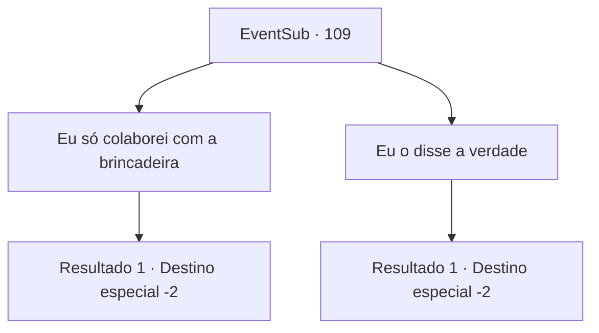

# Eventos secundários · 109

[Índice da tabela](index.md) · [Índice geral](../index.md)

ID: `pt:EventSub:109` · Fonte: `EventSub4` · Versão: 1.2.47.

Mapeamento estático dos arquivos; a disponibilidade e a execução dependem do estado da run.

## Texto do evento

*Sem texto no arquivo.*

## Dados de entrada

```json
{
  "id": 109,
  "grade": 1,
  "subEvent": "",
  "required": ""
}
```

## Mapa das escolhas



## Escolhas e resultados

### Escolha 1

Eu só colaborei com a brincadeira

Requisitos e outros campos da escolha:

```json
{
  "required": ""
}
```

#### Resultado 1.1

Ele solta um suspiro de alívio enquanto continua. 

 "Ufa... Eu sei que é pedir demais... mas por favor, não conte nada sobre o passado para a criança. Melhor ainda, fique longe completamente. Eu... vou confessar isso quando for a hora certa. Eu te imploro."

 Ele te entrega um pequeno escudo. Então ele segue a criança para o orfanato. Você deixa o lugar para trás e continua sua jornada.

Continuação registrada: [Destino especial `-2`](../destinos-especiais.md).

```json
{
  "required": "",
  "chance": "1",
  "nextEvent": -2,
  "type": 2,
  "reward": "3_119_1|12_3_-1|14_3_7|0_2_1"
}
```

### Escolha 2

Eu o disse a verdade

Requisitos e outros campos da escolha:

```json
{
  "required": "5_105_2"
}
```

#### Resultado 2.1

Seu rosto se contorce em desespero. 

 "Não, não... A criança é muito jovem! Por que você... Meu Deus..."

 Ele solta um suspiro e corre para dentro do orfanato. Você deixa o lugar para trás e continua sua jornada.

Continuação registrada: [Destino especial `-2`](../destinos-especiais.md).

```json
{
  "required": "",
  "chance": "1",
  "nextEvent": -2,
  "type": 2,
  "reward": "12_3_-1|14_3_8|0_2_1"
}
```

## Referências que chegam a este evento

- [Evento 107 · escolha 2 · resultado 1](0107.md#escolha-2)
- [Evento 108 · escolha 1 · resultado 1](0108.md#escolha-1)
- [Evento 108 · escolha 3 · resultado 1](0108.md#escolha-3)
