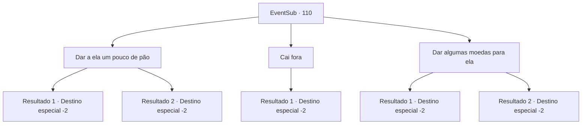

# Eventos secundários · 110

[Índice da tabela](index.md) · [Índice geral](../index.md)

ID: `pt:EventSub:110` · Fonte: `EventSub4` · Versão: 1.2.47.

Mapeamento estático dos arquivos; a disponibilidade e a execução dependem do estado da run.

## Texto do evento

Você está descansando à beira de um lago ao pôr do sol quando percebe um grupo de refugiados. Eles parecem exaustos enquanto quase caem contra os troncos das árvores para uma pausa. Você pode dizer que eles não estão exatamente em alto astral, sentados ao redor de uma velha diligência em silêncio. Uma garota sai do grupo e vai até você. Ela olha para você com uma boneca suja nos braços. Você ouve um pequeno ronco em seu estômago.

## Dados de entrada

```json
{
  "id": 110,
  "grade": 1,
  "subEvent": "4",
  "required": "12_4_0"
}
```

## Mapa das escolhas



## Escolhas e resultados

### Escolha 1

Dar a ela um pouco de pão

Requisitos e outros campos da escolha:

```json
{
  "required": ""
}
```

#### Resultado 1.1

Você compartilha seu pão com o garoto. Ela mordinha sua parte com sua boca pequena, o que lembra os filhotes de besta. Então ela se inclina e volta ao seu grupo. Mas algum tempo depois, ela volta, Desta vez com uma mulher que presumivelmente é sua mãe. |drawing_bruihe| Ela é extremamente fina e coberta de trapos, Mas você pode ver uma elegância determinada em seu movimento. 

 "Eu sou Bruges of Rixhelm. Obrigado por ser gentil com minha filha. Que seu caminho seja tão agradável quanto a primavera, aventureiro."

 A mulher se inclina educadamente, e a garotinha também. Eles desejam sorte e retornam ao seu acampamento.

Continuação registrada: [Destino especial `-2`](../destinos-especiais.md).

```json
{
  "required": "",
  "chance": "1",
  "nextEvent": -2,
  "type": 2,
  "reward": "12_4_1|0_2_1"
}
```

#### Resultado 1.2

Você compartilha seu pão com o garoto. Ela mordinha sua parte com sua boca pequena, o que lembra os filhotes de besta. Então ela se inclina e volta ao seu grupo. Mas algum tempo depois, ela volta, Desta vez com a mãe. |drawing_bruihe| Ela é extremamente fina e coberta de trapos, Mas você pode ver uma elegância determinada em seu movimento. 

 "Eu sou Bruges of Rixhelm. Obrigado por ser gentil com minha filha. Que seu caminho seja tão agradável quanto a primavera, aventureiro."

 A mulher se inclina educadamente, e a garotinha também. Você assume que eles são das regiões mais frias, a julgar pela maneira como ela usa a palavra 'primavera'. Eles desejam sorte e retornam ao seu acampamento.

Continuação registrada: [Destino especial `-2`](../destinos-especiais.md).

```json
{
  "required": "1_14_10",
  "chance": "1",
  "nextEvent": -2,
  "type": 2,
  "reward": "12_4_1|0_2_1"
}
```

### Escolha 2

Cai fora

Requisitos e outros campos da escolha:

```json
{
  "required": ""
}
```

#### Resultado 2.1

Você afasta a criança de forma bastante rude. Lágrimas surgem em seus olhos enquanto ela se vira.

Continuação registrada: [Destino especial `-2`](../destinos-especiais.md).

```json
{
  "required": "",
  "chance": "1",
  "nextEvent": -2,
  "type": 2,
  "reward": "12_4_-1|0_3_-1|0_2_1"
}
```

### Escolha 3

Dar algumas moedas para ela

Requisitos e outros campos da escolha:

```json
{
  "required": "1_4_10"
}
```

#### Resultado 3.1

Você oferece algumas de suas moedas ao garoto. Ela sorri enquanto os observa brilhar contra a luz do sol. Então ela pula para o acampamento. Algum tempo depois, ela volta, Desta vez com a mãe. |drawing_bruihe| Ela é extremamente fina e coberta de trapos, Mas você pode ver uma elegância determinada em seu movimento. 

 "Eu sou Bruges of Rixhelm. Obrigado por ser gentil com minha filha. Que seu caminho seja tão agradável quanto a primavera, aventureiro."

 A mulher se inclina educadamente, e a garotinha também. Você assume que eles são das regiões mais frias, a julgar pela maneira como ela usa a palavra 'primavera'. Eles desejam sorte e retornam ao seu acampamento.

Continuação registrada: [Destino especial `-2`](../destinos-especiais.md).

```json
{
  "required": "",
  "chance": "1",
  "nextEvent": -2,
  "type": 2,
  "reward": "12_4_1|0_4_-10|0_3_2|0_2_1"
}
```

#### Resultado 3.2

Você oferece algumas de suas moedas ao garoto. Ela sorri enquanto os observa brilhar contra a luz do sol. Então ela pula para o acampamento. Algum tempo depois, ela volta, Desta vez com a mãe. |drawing_bruihe| Ela é extremamente fina e coberta de trapos, Mas você pode ver uma elegância determinada em seu movimento. 

 "Eu sou Bruges of Rixhelm. Obrigado por ser gentil com minha filha. Que seu caminho seja tão agradável quanto a primavera, aventureiro."

 A mulher se inclina educadamente, e a garotinha também. Você assume que eles são das regiões mais frias, a julgar pela maneira como ela usa a palavra 'primavera'. Eles desejam sorte e retornam ao seu acampamento.

Continuação registrada: [Destino especial `-2`](../destinos-especiais.md).

```json
{
  "required": "1_14_10",
  "chance": "1",
  "nextEvent": -2,
  "type": 2,
  "reward": "12_4_1|0_4_-10|0_3_2|0_2_1"
}
```

## Referências que chegam a este evento

Nenhum `nextEvent` positivo da mesma tabela aponta para este nó. Isso não prova que seja inacessível: sorteio e estado de história podem selecioná-lo.

