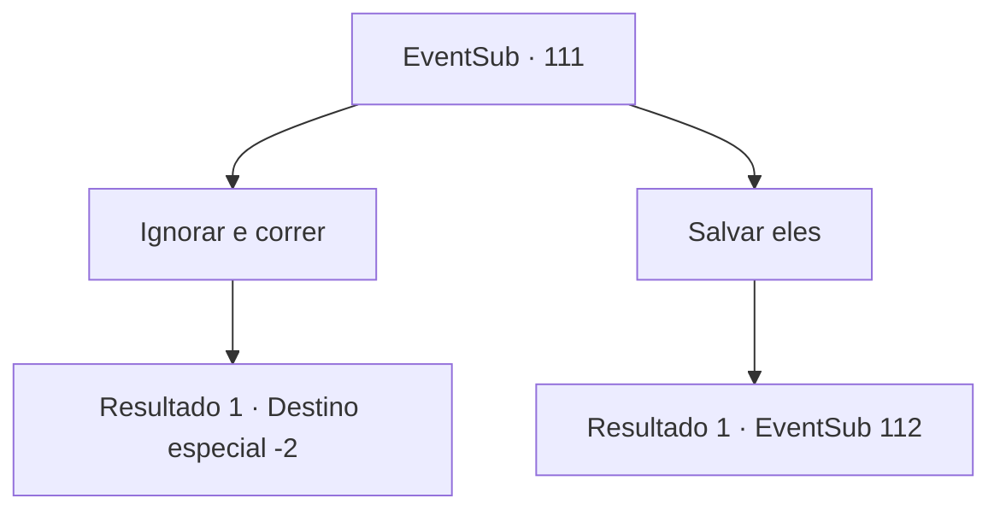

# Eventos secundários · 111

[Índice da tabela](index.md) · [Índice geral](../index.md)

ID: `pt:EventSub:111` · Fonte: `EventSub4` · Versão: 1.2.47.

Mapeamento estático dos arquivos; a disponibilidade e a execução dependem do estado da run.

## Texto do evento

Você está andando pelas planícies sob o luar quando um calafrio percorre sua espinha. Você ouve o uivo de lobos misturado com gritos e o choque de lâminas. Você vai na direção do som e encontrar Bruges e os refugiados travando uma batalha sangrenta com uma matilha de lobos do inverno. |drawing_battleWolves|

## Dados de entrada

```json
{
  "id": 111,
  "grade": 1,
  "subEvent": "",
  "required": "12_4_1"
}
```

## Mapa das escolhas



## Escolhas e resultados

### Escolha 1

Ignorar e correr

Requisitos e outros campos da escolha:

```json
{
  "required": ""
}
```

#### Resultado 1.1

Você ignora os refugiados e os deixa lidar com os lobos sozinhos.

Continuação registrada: [Destino especial `-2`](../destinos-especiais.md).

```json
{
  "required": "",
  "chance": "1",
  "nextEvent": -2,
  "type": 2,
  "reward": "12_4_-1|0_3_-1"
}
```

### Escolha 2

Salvar eles

Requisitos e outros campos da escolha:

```json
{
  "required": ""
}
```

#### Resultado 2.1

Você cobra nos lobos de inverno. <link=shake> 

 "grrrrrr ...!"

 </link> Você pode ver o vapor branco ao redor das mandíbulas. O pacote se lança para a frente.

Continuação registrada: [Evento 112](0112.md) na mesma tabela.

```json
{
  "required": "",
  "chance": "1",
  "nextEvent": 112,
  "type": 2,
  "reward": "6_2_88",
  "place": 14
}
```

## Referências que chegam a este evento

Nenhum `nextEvent` positivo da mesma tabela aponta para este nó. Isso não prova que seja inacessível: sorteio e estado de história podem selecioná-lo.

