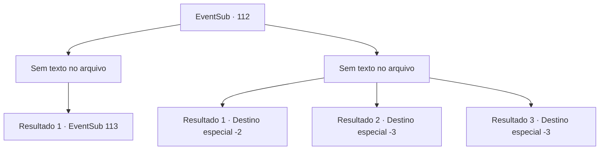

# Eventos secundários · 112

[Índice da tabela](index.md) · [Índice geral](../index.md)

ID: `pt:EventSub:112` · Fonte: `EventSub4` · Versão: 1.2.47.

Mapeamento estático dos arquivos; a disponibilidade e a execução dependem do estado da run.

## Texto do evento

*Sem texto no arquivo.*

## Dados de entrada

```json
{
  "id": 112,
  "grade": 1,
  "subEvent": "",
  "required": ""
}
```

## Mapa das escolhas



## Escolhas e resultados

### Escolha 1

*Sem texto no arquivo; o papel dessa opção depende da interface do jogo.*

Requisitos e outros campos da escolha:

```json
{
  "required": ""
}
```

#### Resultado 1.1

Você luta ao lado dos refugiados e derrota os lobos. Alguns sobrevivem e se afastam mancando, sangrando. Os refugiados agradecem a você e começam a tratar dos feridos. Bruges reconhece e se aproxima de você. 

 "Aventureiro! Não sei como te agradecer..."

 Sua voz treme enquanto expressa sua gratidão. A menininha aparece atrás de sua mãe, encharcada de lágrimas de terror. Ela entrega a você sua boneca e se esconde atrás de Bruges. Bruges acaricia a menininha suavemente enquanto fala. 

 "Acho que ela queria te retribuir de alguma forma. Delin, você não vai agradecer?"

 A criança se curva e diz obrigado em voz baixa.

Continuação registrada: [Evento 113](0113.md) na mesma tabela.

```json
{
  "required": "",
  "chance": "1",
  "nextEvent": 113,
  "type": 2,
  "reward": "3_185_1|0_2_1"
}
```

### Escolha 2

*Sem texto no arquivo; o papel dessa opção depende da interface do jogo.*

Requisitos e outros campos da escolha:

```json
{
  "required": ""
}
```

#### Resultado 2.1

Você luta arduamente contra os lobos, mas fica ferido e mal consegue escapar. Os gritos dos refugiados ecoam atrás de você.

Continuação registrada: [Destino especial `-2`](../destinos-especiais.md).

```json
{
  "required": "1_1_2|1_0_2",
  "chance": "1",
  "nextEvent": -2,
  "type": 2,
  "reward": "12_4_-1|0_0_-1|0_1_-1"
}
```

#### Resultado 2.2

Os lobos congelam você com sua respiração gelada.

Continuação registrada: [Destino especial `-3`](../destinos-especiais.md).

```json
{
  "required": "2_0_2",
  "chance": "1",
  "nextEvent": -3,
  "type": 2,
  "reward": "0_0_-1|0_1_-1"
}
```

#### Resultado 2.3

Os lobos congelam você com sua respiração gelada.

Continuação registrada: [Destino especial `-3`](../destinos-especiais.md).

```json
{
  "required": "2_1_2",
  "chance": "1",
  "nextEvent": -3,
  "type": 2,
  "reward": "0_0_-1|0_1_-1"
}
```

## Referências que chegam a este evento

- [Evento 111 · escolha 2 · resultado 1](0111.md#escolha-2)
