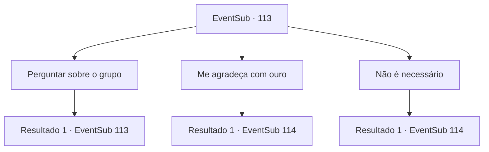

# Eventos secundários · 113

[Índice da tabela](index.md) · [Índice geral](../index.md)

ID: `pt:EventSub:113` · Fonte: `EventSub4` · Versão: 1.2.47.

Mapeamento estático dos arquivos; a disponibilidade e a execução dependem do estado da run.

## Texto do evento

*Sem texto no arquivo.*

## Dados de entrada

```json
{
  "id": 113,
  "grade": 1,
  "subEvent": "",
  "required": ""
}
```

## Mapa das escolhas



## Escolhas e resultados

### Escolha 1

Perguntar sobre o grupo

Requisitos e outros campos da escolha:

```json
{
  "required": "5_123_0"
}
```

#### Resultado 1.1

Ela responde cuidadosamente à sua pergunta. 

 "Nós somos de Rixhelm, ao norte desta região. Era um lugar bonito... com invernos rigorosos, sim, mas também belos e floridos verões."

 Ela suspira, olha para o céu e continua. 

 "Até que um dia, lobos de inverno e espectros atacaram nossas terras. Era pleno verão, mas toda a terra congelou..."

 Ela continua chorando. 

 "Foi a Rainha do Gelo e seus monstros. Nosso povo lutou da melhor forma que pôde, mas não foi suficiente... E como você pode ver, os últimos de nós estão fugindo. Ainda não entendo por que eles invadiram..."


Continuação registrada: [Evento 113](0113.md) na mesma tabela.

```json
{
  "required": "",
  "chance": "1",
  "nextEvent": 113,
  "type": 2,
  "reward": "5_123_1"
}
```

### Escolha 2

Me agradeça com ouro

Requisitos e outros campos da escolha:

```json
{
  "required": "5_123_1"
}
```

#### Resultado 2.1

Ela parece um pouco preocupada. 

 "Eu adoraria... mas no momento, nem temos o suficiente para comer..."

 Com certeza, você percebe que todos eles parecem não ter comido há dias. Ela estende a mão e tira uma pequena flor. 

 "Isso é tudo que tenho. É uma Flor de Gelo que nunca derrete... um tesouro de família nosso. Mas tesouros de família não importam em tempos como este. Você salvou nossas vidas, por favor, pegue-o."

 Ela lhe entrega a flor agradavelmente fria. Ela brilha com uma luz cativante.

Continuação registrada: [Evento 114](0114.md) na mesma tabela.

```json
{
  "required": "",
  "chance": "1",
  "nextEvent": 114,
  "type": 2,
  "reward": "0_3_-1"
}
```

### Escolha 3

Não é necessário

Requisitos e outros campos da escolha:

```json
{
  "required": "5_123_1"
}
```

#### Resultado 3.1

Você diz a ela que não espera nada em troca. Ela acena graciosamente e continua. 

 "Isso é tudo o que tenho. É uma Flor de Gelo que nunca derrete... um tesouro de família nosso. Mas tesouros de família não importam em tempos como este. Você salvou nossas vidas, por favor, pegue-o."

 Ela lhe entrega a flor agradavelmente fria. Ela brilha com uma luz cativante.

Continuação registrada: [Evento 114](0114.md) na mesma tabela.

```json
{
  "required": "",
  "chance": "1",
  "nextEvent": 114,
  "type": 2,
  "reward": "0_3_1"
}
```

## Referências que chegam a este evento

- [Evento 112 · escolha 1 · resultado 1](0112.md#escolha-1)
- [Evento 113 · escolha 1 · resultado 1](0113.md#escolha-1)
