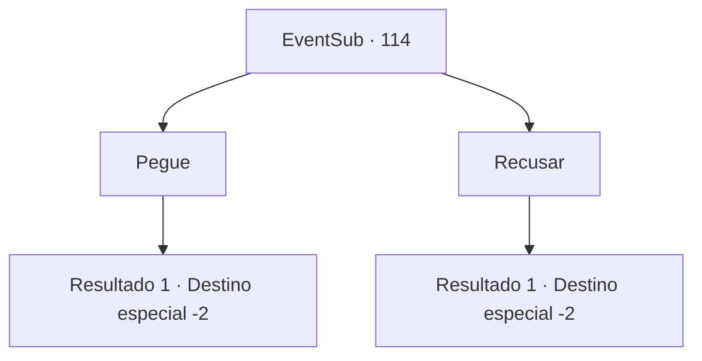

# Eventos secundários · 114

[Índice da tabela](index.md) · [Índice geral](../index.md)

ID: `pt:EventSub:114` · Fonte: `EventSub4` · Versão: 1.2.47.

Mapeamento estático dos arquivos; a disponibilidade e a execução dependem do estado da run.

## Texto do evento

*Sem texto no arquivo.*

## Dados de entrada

```json
{
  "id": 114,
  "grade": 1,
  "subEvent": "",
  "required": ""
}
```

## Mapa das escolhas



## Escolhas e resultados

### Escolha 1

Pegue

Requisitos e outros campos da escolha:

```json
{
  "required": ""
}
```

#### Resultado 1.1

Você pega a Flor da Geada. Bruges olha para ela enquanto conta uma história transmitida ao longo das gerações. 

 "Uma antiga lenda diz... que esta flor protege nossa família e suas terras. Mas acho que é apenas uma história afinal, considerando o que aconteceu conosco."

 Ela diz que seu povo está indo para uma cidade chamada Nove Caudas, que é governada por seus primos. Você se despede de Bruges e dos refugiados e continua sua jornada.

Continuação registrada: [Destino especial `-2`](../destinos-especiais.md).

```json
{
  "required": "",
  "chance": "1",
  "nextEvent": -2,
  "type": 2,
  "reward": "3_184_1|12_4_3|0_2_2"
}
```

### Escolha 2

Recusar

Requisitos e outros campos da escolha:

```json
{
  "required": ""
}
```

#### Resultado 2.1

Você se recusa a reivindicar o tesouro da família deles. Bruges abaixa a cabeça em sinal de desculpas. 

 "Obrigado pela sua ajuda. Por favor, leve isso em vez disso."

 Ela empurra seu escudo em seus braços. Ele está um pouco desgastado, mas em ótimas condições. Você se despede de Bruges e dos refugiados e continua sua jornada.

Continuação registrada: [Destino especial `-2`](../destinos-especiais.md).

```json
{
  "required": "",
  "chance": "1",
  "nextEvent": -2,
  "type": 2,
  "reward": "3_121_1|12_4_2|0_2_2"
}
```

## Referências que chegam a este evento

- [Evento 113 · escolha 2 · resultado 1](0113.md#escolha-2)
- [Evento 113 · escolha 3 · resultado 1](0113.md#escolha-3)
