# Eventos secundários · 115

[Índice da tabela](index.md) · [Índice geral](../index.md)

ID: `pt:EventSub:115` · Fonte: `EventSub4` · Versão: 1.2.47.

Mapeamento estático dos arquivos; a disponibilidade e a execução dependem do estado da run.

## Texto do evento

Você encontra Bruges e os refugiados mais uma vez ao pôr do sol. Eles estão sentados ao redor de sua carruagem degradada, amontoados contra uma fogueira, e parecem ainda mais cansados ​​e em menor número do que antes. |drawing_wagonAndpeople| Bruges e sua filha notam você e se aproximam. A garotinha parece encantada, como ela o cumprimenta muito educadamente, talvez educada demais para sua idade. 

 "Ah...{1}! Esqueci de me apresentar da última vez. Meu nome é Delin, filha de Bruges."

 Delin então recua e se esconde atrás de sua mãe. Bruges sorri para ela com orgulho antes de se voltar para você. 

 "Prazer em conhecê-lo novamente. Embora, como você pode ver, estamos ainda pior do que antes... Você poderia nos ajudar só mais uma vez? Lamentamos muito pedir tanto de você..."


## Dados de entrada

```json
{
  "id": 115,
  "grade": 1,
  "subEvent": "",
  "required": "12_4_2"
}
```

## Mapa das escolhas

```mermaid
flowchart TD
  E["EventSub · 115"]
  C0["Ajudar eles"]
  E --> C0
  R0_0["Resultado 1 · EventSub 116"]
  C0 --> R0_0
  C1["Recusar"]
  E --> C1
  R1_0["Resultado 1 · Destino especial -2"]
  C1 --> R1_0
```



## Escolhas e resultados

### Escolha 1

Ajudar eles

Requisitos e outros campos da escolha:

```json
{
  "required": ""
}
```

#### Resultado 1.1

Você concorda em ajudá-la. Ela sorri e faz uma leve reverência. Então ela começa a te atualizar sobre o que aconteceu. De acordo com ela, os lobos de inverno e os espectros atacaram novamente, e muitos perderam suas vidas. Ela treme enquanto continua. 

 "Acho que a Rainha do Gelo não vai parar até matar todos nós... Nem temos forças suficientes para fugir mais. Eles virão atrás de nós novamente em breve. O que devemos fazer..?"

 Ela suspira chorosamente.

Continuação registrada: [Evento 116](0116.md) na mesma tabela.

```json
{
  "required": "",
  "chance": "1",
  "nextEvent": 116,
  "type": 2,
  "reward": ""
}
```

### Escolha 2

Recusar

Requisitos e outros campos da escolha:

```json
{
  "required": ""
}
```

#### Resultado 2.1

Você se recusa a ajudá-la. Seu rosto fica sombrio, mas ela tenta esconder isso com um sorriso. 

 "Bem... Isso é uma pena. Desculpe por desperdiçar seu tempo."

 Ela se curva e retorna ao seu acampamento com Delin.

Continuação registrada: [Destino especial `-2`](../destinos-especiais.md).

```json
{
  "required": "",
  "chance": "1",
  "nextEvent": -2,
  "type": 2,
  "reward": "12_4_-1"
}
```

## Referências que chegam a este evento

Nenhum `nextEvent` positivo da mesma tabela aponta para este nó. Isso não prova que seja inacessível: sorteio e estado de história podem selecioná-lo.

