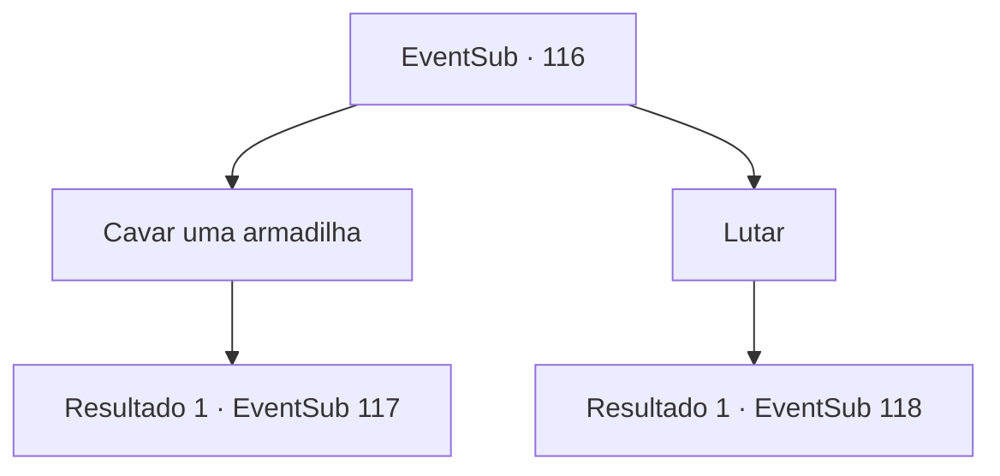

# Eventos secundários · 116

[Índice da tabela](index.md) · [Índice geral](../index.md)

ID: `pt:EventSub:116` · Fonte: `EventSub4` · Versão: 1.2.47.

Mapeamento estático dos arquivos; a disponibilidade e a execução dependem do estado da run.

## Texto do evento

*Sem texto no arquivo.*

## Dados de entrada

```json
{
  "id": 116,
  "grade": 1,
  "subEvent": "",
  "required": ""
}
```

## Mapa das escolhas



## Escolhas e resultados

### Escolha 1

Cavar uma armadilha

Requisitos e outros campos da escolha:

```json
{
  "required": "1_7_12"
}
```

#### Resultado 1.1

Você sugere armar uma armadilha e atrair os inimigos. Os refugiados estão exaustos, mas eles decidem confiar em você, já que você os ajudou antes. Bruges pergunta que tipo de armadilha você tem em mente.

Continuação registrada: [Evento 117](0117.md) na mesma tabela.

```json
{
  "required": "",
  "chance": "1",
  "nextEvent": 117,
  "type": 2,
  "reward": ""
}
```

### Escolha 2

Lutar

Requisitos e outros campos da escolha:

```json
{
  "required": ""
}
```

#### Resultado 2.1

Você sugere que todos eles devem revidar contra seus perseguidores. Bruges parece atordoado. 

 "Mas... mas nós..."

 Um dos refugiados mais jovens interrompe e grita. 

 "Ótimo! Eu prefiro morrer lutando ao seu lado do que sair correndo novamente!"

 Outros se juntam e se reúnem ao seu redor, armas em mãos. Todos parecem determinados a lutar. De repente, um vento frio passa pela sua pele. 

 "É... são eles! Eles estão aqui!"

 Uma dúzia de lobos de inverno e espectros se aproximam de cima da colina. Os lobos vêm correndo e a batalha começa.

Continuação registrada: [Evento 118](0118.md) na mesma tabela.

```json
{
  "required": "",
  "chance": "1",
  "nextEvent": 118,
  "type": 2,
  "reward": "6_0_88",
  "place": 14
}
```

## Referências que chegam a este evento

- [Evento 115 · escolha 1 · resultado 1](0115.md#escolha-1)
