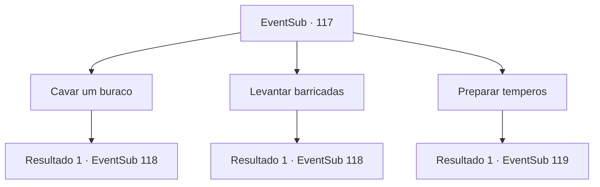

# Eventos secundários · 117

[Índice da tabela](index.md) · [Índice geral](../index.md)

ID: `pt:EventSub:117` · Fonte: `EventSub4` · Versão: 1.2.47.

Mapeamento estático dos arquivos; a disponibilidade e a execução dependem do estado da run.

## Texto do evento

*Sem texto no arquivo.*

## Dados de entrada

```json
{
  "id": 117,
  "grade": 1,
  "subEvent": "",
  "required": ""
}
```

## Mapa das escolhas



## Escolhas e resultados

### Escolha 1

Cavar um buraco

Requisitos e outros campos da escolha:

```json
{
  "required": ""
}
```

#### Resultado 1.1

Você e os refugiados cavam alguns buracos e os revestem com estacas de madeira. Não muito tempo depois, um vento frio passa pela sua pele. 

 "São... são eles! Eles estão aqui!"

 Uma dúzia de lobos de inverno e espectros se aproximam de cima da colina. Os lobos vêm correndo primeiro. Alguns deles morrem nas armadilhas, mas o restante desvia dos buracos e avança em sua direção.

Continuação registrada: [Evento 118](0118.md) na mesma tabela.

```json
{
  "required": "",
  "chance": "1",
  "nextEvent": 118,
  "type": 2,
  "reward": "6_2_88",
  "place": 14
}
```

### Escolha 2

Levantar barricadas

Requisitos e outros campos da escolha:

```json
{
  "required": ""
}
```

#### Resultado 2.1

Você e os refugiados erguem barricadas de madeira. Não muito tempo depois, um vento frio passa pela sua pele. 

 "É... é eles! Eles estão aqui!"

 Uma dúzia de lobos de inverno e espectros se aproximam de cima da colina. Os lobos vêm correndo primeiro e, embora hesitem momentaneamente, logo arrombam as barricadas e passam por elas. Sangrando, mas sem serem afetados, os lobos continuam correndo.

Continuação registrada: [Evento 118](0118.md) na mesma tabela.

```json
{
  "required": "",
  "chance": "1",
  "nextEvent": 118,
  "type": 2,
  "reward": "6_2_88",
  "place": 14
}
```

### Escolha 3

Preparar temperos

Requisitos e outros campos da escolha:

```json
{
  "required": "1_7_15"
}
```

#### Resultado 3.1

Você decide usar as capacidades olfativas dos lobos contra eles. Você coleta várias especiarias dos refugiados e os mistura em bolsas de couro com pimenta de uma lanchonete local. Pouco tempo depois, um vento frio passa pela sua pele. 

 "É ... são eles! Eles estão aqui!"

 Uma dúzia de lobos de inverno e wights se aproximam de cima da colina. Os refugiados jogam seus spice-pays nos lobos, E o composto invade seus narizes. Os lobos ficam incapacitados enquanto arranham ou esfregam freneticamente o nariz. <link=shake> 

 "mate 'eles!"

 </link> Os refugiados balançam seus machados e espadas através da mochila e os aniquilam. Mas os Wights não são afetados pelas especiarias, pois eles chegam a você com punhos cerrados.

Continuação registrada: [Evento 119](0119.md) na mesma tabela.

```json
{
  "required": "",
  "chance": "1",
  "nextEvent": 119,
  "type": 2,
  "reward": "6_0_89",
  "place": 14
}
```

## Referências que chegam a este evento

- [Evento 116 · escolha 1 · resultado 1](0116.md#escolha-1)
