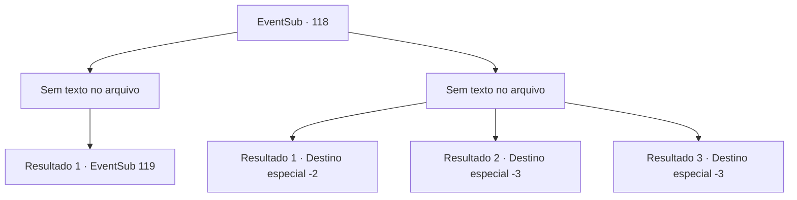

# Eventos secundários · 118

[Índice da tabela](index.md) · [Índice geral](../index.md)

ID: `pt:EventSub:118` · Fonte: `EventSub4` · Versão: 1.2.47.

Mapeamento estático dos arquivos; a disponibilidade e a execução dependem do estado da run.

## Texto do evento

*Sem texto no arquivo.*

## Dados de entrada

```json
{
  "id": 118,
  "grade": 1,
  "subEvent": "",
  "required": ""
}
```

## Mapa das escolhas



## Escolhas e resultados

### Escolha 1

*Sem texto no arquivo; o papel dessa opção depende da interface do jogo.*

Requisitos e outros campos da escolha:

```json
{
  "required": ""
}
```

#### Resultado 1.1

Juntos, você e os refugiados derrotam os lobos de inverno. <link=shake> 

 "nós ganhamos !! Nós realmente ganhamos!"

 </link> Mas a torcida deles é interrompida pelos gritos de cobrar wights.

Continuação registrada: [Evento 119](0119.md) na mesma tabela.

```json
{
  "required": "",
  "chance": "1",
  "nextEvent": 119,
  "type": 2,
  "reward": "6_0_89",
  "place": 14
}
```

### Escolha 2

*Sem texto no arquivo; o papel dessa opção depende da interface do jogo.*

Requisitos e outros campos da escolha:

```json
{
  "required": ""
}
```

#### Resultado 2.1

Um lobo te derruba com seu sopro congelante. Você acorda algum tempo depois e se vê cercado pelos corpos dos caídos. Bruges e Delin também foram congelados. Você presta suas homenagens e segue em frente.

Continuação registrada: [Destino especial `-2`](../destinos-especiais.md).

```json
{
  "required": "1_1_2|1_0_2",
  "chance": "1",
  "nextEvent": -2,
  "type": 2,
  "reward": "0_0_-1|0_1_-1|14_4_1|12_4_-1|0_2_1"
}
```

#### Resultado 2.2

Os lobos congelam você com sua respiração gelada.

Continuação registrada: [Destino especial `-3`](../destinos-especiais.md).

```json
{
  "required": "2_0_2",
  "chance": "1",
  "nextEvent": -3,
  "type": 2,
  "reward": "0_0_-1|0_1_-1"
}
```

#### Resultado 2.3

Os lobos congelam você com sua respiração gelada.

Continuação registrada: [Destino especial `-3`](../destinos-especiais.md).

```json
{
  "required": "2_1_2",
  "chance": "1",
  "nextEvent": -3,
  "type": 2,
  "reward": "0_0_-1|0_1_-1"
}
```

## Referências que chegam a este evento

- [Evento 116 · escolha 2 · resultado 1](0116.md#escolha-2)
- [Evento 117 · escolha 1 · resultado 1](0117.md#escolha-1)
- [Evento 117 · escolha 2 · resultado 1](0117.md#escolha-2)
