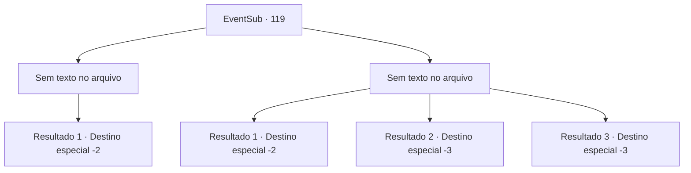

# Eventos secundários · 119

[Índice da tabela](index.md) · [Índice geral](../index.md)

ID: `pt:EventSub:119` · Fonte: `EventSub4` · Versão: 1.2.47.

Mapeamento estático dos arquivos; a disponibilidade e a execução dependem do estado da run.

## Texto do evento

*Sem texto no arquivo.*

## Dados de entrada

```json
{
  "id": 119,
  "grade": 1,
  "subEvent": "",
  "required": ""
}
```

## Mapa das escolhas



## Escolhas e resultados

### Escolha 1

*Sem texto no arquivo; o papel dessa opção depende da interface do jogo.*

Requisitos e outros campos da escolha:

```json
{
  "required": ""
}
```

#### Resultado 1.1

Você derrota o último wight de pé. Ele olha fixamente para você de joelhos. 

 "Isso não é o fim... Vocês todos são..."

 A voz sinistra do wight é interrompida por um estrondo. Bruges, ofegante, joga a pedra que usou para esmagar sua cabeça e recupera o fôlego. 

 "Obrigado... obrigado pela sua ajuda, {1}. Agora iremos para as colinas do sul, em direção à cidade de Nine Tails, onde meu primo está no comando. Sempre lembraremos do que você fez por nós."

 Bruges se curva graciosamente e os outros também agradecem a você.

Continuação registrada: [Destino especial `-2`](../destinos-especiais.md).

```json
{
  "required": "",
  "chance": "1",
  "nextEvent": -2,
  "type": 2,
  "reward": "0_3_5|14_4_0|12_4_4|5_199_1"
}
```

### Escolha 2

*Sem texto no arquivo; o papel dessa opção depende da interface do jogo.*

Requisitos e outros campos da escolha:

```json
{
  "required": ""
}
```

#### Resultado 2.1

Um chute de um wight te faz cair no chão. Você acorda algum tempo depois e se vê cercado pelos corpos dos caídos. Bruges e Delin também foram congelados. Você presta suas homenagens e segue em frente.

Continuação registrada: [Destino especial `-2`](../destinos-especiais.md).

```json
{
  "required": "1_1_2|1_0_2",
  "chance": "1",
  "nextEvent": -2,
  "type": 2,
  "reward": "0_0_-1|0_1_-1|14_4_1|12_4_-1|0_2_1"
}
```

#### Resultado 2.2

Um chute de um wight te faz cair no chão. O mundo fica escuro.

Continuação registrada: [Destino especial `-3`](../destinos-especiais.md).

```json
{
  "required": "2_0_2",
  "chance": "1",
  "nextEvent": -3,
  "type": 2,
  "reward": "0_0_-1|0_1_-1"
}
```

#### Resultado 2.3

Um chute de um wight te faz cair no chão. O mundo fica escuro.

Continuação registrada: [Destino especial `-3`](../destinos-especiais.md).

```json
{
  "required": "2_1_2",
  "chance": "1",
  "nextEvent": -3,
  "type": 2,
  "reward": "0_0_-1|0_1_-1"
}
```

## Referências que chegam a este evento

- [Evento 117 · escolha 3 · resultado 1](0117.md#escolha-3)
- [Evento 118 · escolha 1 · resultado 1](0118.md#escolha-1)
