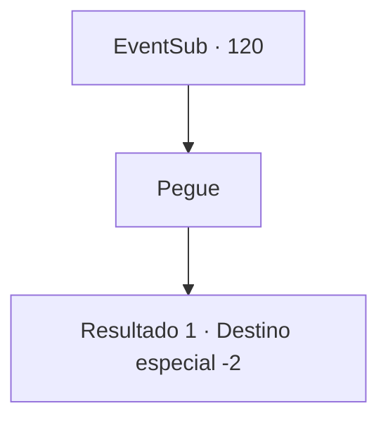

# Eventos secundários · 120

[Índice da tabela](index.md) · [Índice geral](../index.md)

ID: `pt:EventSub:120` · Fonte: `EventSub4` · Versão: 1.2.47.

Mapeamento estático dos arquivos; a disponibilidade e a execução dependem do estado da run.

## Texto do evento

Um homem carregando uma bandeira se aproxima de você. Ele afirma ser um mensageiro de Rixhelm enquanto tira um pergaminho do bolso. 

 "Olá, {1}. Estou escrevendo para retribuir o favor que você fez por nós em nossa hora mais sombria. Agradecemos mais uma vez por salvar nossas vidas e esperamos que você faça bom uso do nosso presente. -Bruges-"

 O mensageiro lhe entrega um item embrulhado em pano.

## Dados de entrada

```json
{
  "id": 120,
  "grade": 1,
  "subEvent": "",
  "required": "12_4_4"
}
```

## Mapa das escolhas



## Escolhas e resultados

### Escolha 1

Pegue

Requisitos e outros campos da escolha:

```json
{
  "required": ""
}
```

#### Resultado 1.1

Por baixo das embalagens, você encontra um machado com um emblema único esculpido em sua superfície, juntamente com um chifre de marfim. O mensageiro agradece mais uma vez em nome de Bruges e parte.

Continuação registrada: [Destino especial `-2`](../destinos-especiais.md).

```json
{
  "required": "",
  "chance": "1",
  "nextEvent": -2,
  "type": 2,
  "reward": "3_186_1|3_182_1|12_4_-1|0_2_1"
}
```

## Referências que chegam a este evento

Nenhum `nextEvent` positivo da mesma tabela aponta para este nó. Isso não prova que seja inacessível: sorteio e estado de história podem selecioná-lo.

