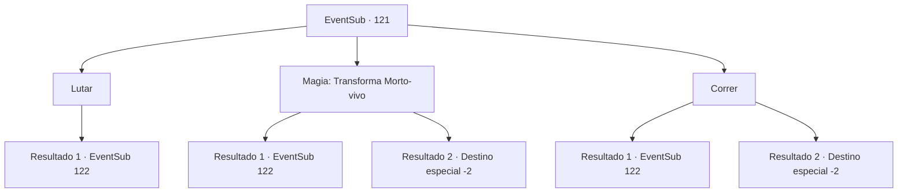

# Eventos secundários · 121

[Índice da tabela](index.md) · [Índice geral](../index.md)

ID: `pt:EventSub:121` · Fonte: `EventSub4` · Versão: 1.2.47.

Mapeamento estático dos arquivos; a disponibilidade e a execução dependem do estado da run.

## Texto do evento

O sol está se pondo e você sente um vento frio contra sua pele. Você decide passar a noite no que parece ser uma cabana abandonada. Então você ouve a voz familiar de uma mulher. <link=wave>

 "Que...seu c-caminho...seja tão agradável...como a primavera..."

</link> Você abre a porta da cabine e sai para encontrar Bruges. Mas ela não é quem costumava ser.
 |drawing_deadBruihe| A pele dela ficou azul, as pupilas perderam o foco e você pode sentir o cheiro da carne dela apodrecendo...
 Ela se tornou um morto-vivo, murmurando promessas de primavera que nunca chegarão. Você olha em volta e descobre que os outros refugiados também se tornaram cadáveres ambulantes.

## Dados de entrada

```json
{
  "id": 121,
  "grade": 1,
  "subEvent": "",
  "required": "1_2_30|12_4_3"
}
```

## Mapa das escolhas



## Escolhas e resultados

### Escolha 1

Lutar

Requisitos e outros campos da escolha:

```json
{
  "required": ""
}
```

#### Resultado 1.1

Você decide libertar suas almas. Ao tirar sua arma, os mortos-vivos correm em sua direção de uma vez só.

Continuação registrada: [Evento 122](0122.md) na mesma tabela.

```json
{
  "required": "",
  "chance": "1",
  "nextEvent": 122,
  "type": 2,
  "reward": "6_3_89",
  "place": 14
}
```

### Escolha 2

Magia: Transforma Morto-vivo

Requisitos e outros campos da escolha:

```json
{
  "required": "20_0_1|20_3_1"
}
```

#### Resultado 2.1

Tentas lançar um feitiço sagrado que é eficaz contra os mortos-vivos, mas, na tua pressa, falhas. O cheiro deles torna-se mais forte à medida que se aproximam de ti.

Continuação registrada: [Evento 122](0122.md) na mesma tabela.

```json
{
  "required": "",
  "chance": "12",
  "nextEvent": 122,
  "type": 1,
  "reward": "6_3_89",
  "place": 14
}
```

#### Resultado 2.2

Você lança um feitiço sagrado eficaz contra os mortos-vivos. Um raio de luz quente dispara de suas pontas dos dedos em direção a Bruges e aos refugiados, e eles caem como marionetes sem cordas. As últimas palavras de Bruges ecoam em sua cabeça. 

 "Que seu caminho seja tão agradável quanto a primavera"

 Não haverá primavera para onde eles estão indo, mas você diz as palavras de qualquer maneira depois de enterrar seus restos. Você se vira e continua sua jornada.

Continuação registrada: [Destino especial `-2`](../destinos-especiais.md).

```json
{
  "required": "",
  "chance": "1|0_14_1",
  "nextEvent": -2,
  "type": 0,
  "reward": "12_4_5"
}
```

### Escolha 3

Correr

Requisitos e outros campos da escolha:

```json
{
  "required": ""
}
```

#### Resultado 3.1

Você foge deles o mais rápido que pode, mas logo se vê cercado. O cheiro deles fica mais forte conforme eles se aproximam de você.

Continuação registrada: [Evento 122](0122.md) na mesma tabela.

```json
{
  "required": "",
  "chance": "10",
  "nextEvent": 122,
  "type": 1,
  "reward": "6_0_89",
  "place": 14
}
```

#### Resultado 3.2

Você corre deles o mais rápido que pode até eles pararem de te perseguir.

Continuação registrada: [Destino especial `-2`](../destinos-especiais.md).

```json
{
  "required": "",
  "chance": "1|0_6_1",
  "nextEvent": -2,
  "type": 0,
  "reward": "12_4_5"
}
```

## Referências que chegam a este evento

Nenhum `nextEvent` positivo da mesma tabela aponta para este nó. Isso não prova que seja inacessível: sorteio e estado de história podem selecioná-lo.

