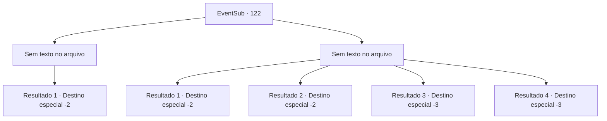

# Eventos secundários · 122

[Índice da tabela](index.md) · [Índice geral](../index.md)

ID: `pt:EventSub:122` · Fonte: `EventSub4` · Versão: 1.2.47.

Mapeamento estático dos arquivos; a disponibilidade e a execução dependem do estado da run.

## Texto do evento

*Sem texto no arquivo.*

## Dados de entrada

```json
{
  "id": 122,
  "grade": 1,
  "subEvent": "",
  "required": ""
}
```

## Mapa das escolhas



## Escolhas e resultados

### Escolha 1

*Sem texto no arquivo; o papel dessa opção depende da interface do jogo.*

Requisitos e outros campos da escolha:

```json
{
  "required": ""
}
```

#### Resultado 1.1

Você derrota todos os restos mortais dos mortos-vivos que um dia conheceu. As últimas palavras de Bruges ecoam em sua cabeça. 

 "Que seu caminho seja tão agradável quanto a primavera"

 Não haverá primavera para onde eles estão indo, mas você diz as palavras mesmo assim depois de enterrar seus restos. Você se vira e continua sua jornada.

Continuação registrada: [Destino especial `-2`](../destinos-especiais.md).

```json
{
  "required": "",
  "chance": "1",
  "nextEvent": -2,
  "type": 2,
  "reward": "12_4_5"
}
```

### Escolha 2

*Sem texto no arquivo; o papel dessa opção depende da interface do jogo.*

Requisitos e outros campos da escolha:

```json
{
  "required": ""
}
```

#### Resultado 2.1

Você fica ferido pelos mortos-vivos e cai no chão. Eles se aproximam de você e pegam a Flor de Gelo. Em seguida, eles se afastam, como se a flor fosse tudo pelo que vieram.

Continuação registrada: [Destino especial `-2`](../destinos-especiais.md).

```json
{
  "required": "1_1_2|1_0_2|8_184_1",
  "chance": "1",
  "nextEvent": -2,
  "type": 2,
  "reward": "4_184_1|12_4_-1|14_4_5|0_2_1"
}
```

#### Resultado 2.2

Ferido pelos mortos-vivos, você cai no chão. Eles se aproximam de você e pegam a Flor de Gelo. Em seguida, eles se afastam, como se a flor fosse tudo pelo que vieram.

Continuação registrada: [Destino especial `-2`](../destinos-especiais.md).

```json
{
  "required": "1_1_2|1_0_2|10_184_1",
  "chance": "1",
  "nextEvent": -2,
  "type": 2,
  "reward": "12_4_-1|14_4_5"
}
```

#### Resultado 2.3

Ferido pelos mortos-vivos, você cai no chão. Você cospe sangue e desmaia.

Continuação registrada: [Destino especial `-3`](../destinos-especiais.md).

```json
{
  "required": "2_0_2",
  "chance": "1",
  "nextEvent": -3,
  "type": 2,
  "reward": "0_0_-1|0_1_-1"
}
```

#### Resultado 2.4

Ferido pelos mortos-vivos, você cai no chão. Você cospe sangue e desmaia.

Continuação registrada: [Destino especial `-3`](../destinos-especiais.md).

```json
{
  "required": "2_1_2",
  "chance": "1",
  "nextEvent": -3,
  "type": 2,
  "reward": "0_0_-1|0_1_-1"
}
```

## Referências que chegam a este evento

- [Evento 121 · escolha 1 · resultado 1](0121.md#escolha-1)
- [Evento 121 · escolha 2 · resultado 1](0121.md#escolha-2)
- [Evento 121 · escolha 3 · resultado 1](0121.md#escolha-3)
