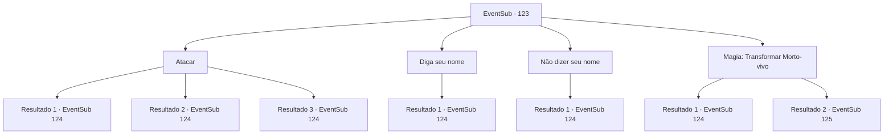

# Eventos secundários · 123

[Índice da tabela](index.md) · [Índice geral](../index.md)

ID: `pt:EventSub:123` · Fonte: `EventSub4` · Versão: 1.2.47.

Mapeamento estático dos arquivos; a disponibilidade e a execução dependem do estado da run.

## Texto do evento

Um vento frio atravessa a barraca e seus lençóis. Você percebe que também apagou seu fogo. Você está prestes a sair para reanimá-lo, quando percebe que o chão abaixo de você está coberto de gelo, e o ar é tão frio que dói nos pulmões. Alguém emerge da escuridão. |drawing_frostqueen| É um Lich - um mago morto-vivo - e você percebe que é a Rainha do Gelo que você tem ouvido falar. Suas mandíbulas ósseas se abrem enquanto ela fala. 

 "Eu sou Tatia, a Rainha do Gelo. Qual é o seu nome?"


## Dados de entrada

```json
{
  "id": 123,
  "grade": 1,
  "subEvent": "",
  "required": "12_4_5|1_2_51"
}
```

## Mapa das escolhas



## Escolhas e resultados

### Escolha 1

Atacar

Requisitos e outros campos da escolha:

```json
{
  "required": ""
}
```

#### Resultado 1.1

Você imediatamente começa a atacar a rainha do gelo. Ela se esquiva de seus golpes com facilidade, como se ela os visse chegando. Então ela grita no topo de seus pulmões, <link=shake> 

 "Se a morte for o que você quiser, eu darei a você !!"

 </link>

Continuação registrada: [Evento 124](0124.md) na mesma tabela.

```json
{
  "required": "",
  "chance": "22",
  "nextEvent": 124,
  "type": 1,
  "reward": "6_0_55",
  "place": 14
}
```

#### Resultado 1.2

Você imediatamente atinge a rainha do gelo. Ela prevê seu golpe, mas não é rápido o suficiente. Seu braço ósseo voa sobre o ar e cai no chão. Mas tudo o que seu ataque faz é provocá -la. O lich logo cresce para trás o braço, e as chamas azuis nos olhos afundados brilham mais. Ela grita no topo de seus pulmões, <link=shake> 

 "Se a morte for o que você quiser, eu darei a você !!"

 </link>

Continuação registrada: [Evento 124](0124.md) na mesma tabela.

```json
{
  "required": "",
  "chance": "1|0_6_1",
  "nextEvent": 124,
  "type": 0,
  "reward": "6_0_55",
  "place": 14
}
```

#### Resultado 1.3

Você imediatamente atinge a rainha do gelo. Ela prevê seu golpe, mas não é rápido o suficiente. Seu braço ósseo voa sobre o ar e cai no chão. Então ele se transforma em pó e desaparece. As chamas azuis em seus olhos afundados brilham mais. Ela grita no topo de seus pulmões, <link=shake> 

 "Como você se atreve, mortal inferior ...! Se a morte é o que você quer, eu darei a você !!"

 </link>

Continuação registrada: [Evento 124](0124.md) na mesma tabela.

```json
{
  "required": "20_3_1",
  "chance": "1|0_6_1",
  "nextEvent": 124,
  "type": 0,
  "reward": "6_2_55",
  "place": 14
}
```

### Escolha 2

Diga seu nome

Requisitos e outros campos da escolha:

```json
{
  "required": ""
}
```

#### Resultado 2.1

A Rainha do Gelo acena com a cabeça. 

 "Entendo. Eu irei te matar e te transformar em um dos meus. Você deveria se sentir honrado, {1}."

 Ela levanta a mão e dispara estalactites de seus dedos.

Continuação registrada: [Evento 124](0124.md) na mesma tabela.

```json
{
  "required": "",
  "chance": "1",
  "nextEvent": 124,
  "type": 2,
  "reward": "6_0_55",
  "place": 14
}
```

### Escolha 3

Não dizer seu nome

Requisitos e outros campos da escolha:

```json
{
  "required": ""
}
```

#### Resultado 3.1

Você não responde à pergunta dela. A Rainha do Gelo levanta silenciosamente a mão e dispara estalactites de suas pontas dos dedos.

Continuação registrada: [Evento 124](0124.md) na mesma tabela.

```json
{
  "required": "",
  "chance": "1",
  "nextEvent": 124,
  "type": 2,
  "reward": "6_0_55",
  "place": 14
}
```

### Escolha 4

Magia: Transformar Morto-vivo

Requisitos e outros campos da escolha:

```json
{
  "required": "20_0_1|20_3_1"
}
```

#### Resultado 4.1

Você lança o feitiço Turn Undead na rainha. Não funciona. Ela zomba de sua tentativa. 

 "Tolo humano. Você achou que eu não me prepararia contra sua mágica patética?"

 Ela levanta a mão e dispara estalactites de seus dedos.

Continuação registrada: [Evento 124](0124.md) na mesma tabela.

```json
{
  "required": "21_0_5",
  "chance": "1",
  "nextEvent": 124,
  "type": 1,
  "reward": "6_0_55",
  "place": 14
}
```

#### Resultado 4.2

Você lança o feitiço Turn Undead na rainha. Ela desaba como uma marionete sem cordas. Mas logo ela se levanta novamente. 

 "Impressionante, mortal... Agora estou com ciúmes."

 A Lich murmura, se recuperando do susto. Então ela começa a falar novamente. 

 "Aqui está o acordo, mortal. Entregue a Frost Bloom. Não tem muita utilidade para você de qualquer maneira. Eu lhe darei algo muito mais valioso em troca."


Continuação registrada: [Evento 125](0125.md) na mesma tabela.

```json
{
  "required": "20_0_5",
  "chance": "1",
  "nextEvent": 125,
  "type": 0,
  "reward": ""
}
```

## Referências que chegam a este evento

Nenhum `nextEvent` positivo da mesma tabela aponta para este nó. Isso não prova que seja inacessível: sorteio e estado de história podem selecioná-lo.

