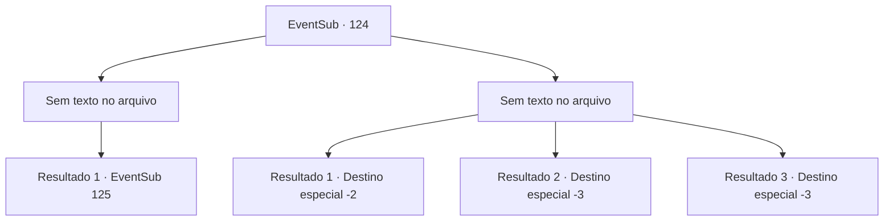

# Eventos secundários · 124

[Índice da tabela](index.md) · [Índice geral](../index.md)

ID: `pt:EventSub:124` · Fonte: `EventSub4` · Versão: 1.2.47.

Mapeamento estático dos arquivos; a disponibilidade e a execução dependem do estado da run.

## Texto do evento

*Sem texto no arquivo.*

## Dados de entrada

```json
{
  "id": 124,
  "grade": 1,
  "subEvent": "",
  "required": ""
}
```

## Mapa das escolhas



## Escolhas e resultados

### Escolha 1

*Sem texto no arquivo; o papel dessa opção depende da interface do jogo.*

Requisitos e outros campos da escolha:

```json
{
  "required": ""
}
```

#### Resultado 1.1

Você atravessa o corpo ossudo da Rainha do Gelo. Mas ela logo se levanta novamente. 

 "Hmm, então você não é completamente inútil afinal. Não gosto dessas lutas sem sentido... Então aqui está o acordo, mortal. Entregue a Flor de Gelo. Não tem muita utilidade para você de qualquer maneira. Eu lhe darei algo muito mais valioso em troca."


Continuação registrada: [Evento 125](0125.md) na mesma tabela.

```json
{
  "required": "",
  "chance": "1",
  "nextEvent": 125,
  "type": 2,
  "reward": ""
}
```

### Escolha 2

*Sem texto no arquivo; o papel dessa opção depende da interface do jogo.*

Requisitos e outros campos da escolha:

```json
{
  "required": ""
}
```

#### Resultado 2.1

Você não é páreo para a rainha do gelo, Mas você consegue segurá -la até o nascer do sol. O Lich desaparece no escuro para se afastar da luz do sol. 'Este não é o fim', ela grita, prometendo voltar.

Continuação registrada: [Destino especial `-2`](../destinos-especiais.md).

```json
{
  "required": "1_1_2|1_0_2",
  "chance": "1",
  "nextEvent": -2,
  "type": 2,
  "reward": "0_0_-1|0_1_-1|14_4_3|12_4_-1|0_2_1"
}
```

#### Resultado 2.2

Você não é páreo para a Rainha do Gelo. Você se transforma em um bloco de gelo, e ela te despedaça em pedaços usando seu punho.

Continuação registrada: [Destino especial `-3`](../destinos-especiais.md).

```json
{
  "required": "2_0_2",
  "chance": "1",
  "nextEvent": -3,
  "type": 2,
  "reward": "0_0_-1|0_1_-1"
}
```

#### Resultado 2.3

Você não é páreo para a Rainha do Gelo. Você se transforma em um bloco de gelo, e ela te despedaça em pedaços usando seu punho.

Continuação registrada: [Destino especial `-3`](../destinos-especiais.md).

```json
{
  "required": "2_1_2",
  "chance": "1",
  "nextEvent": -3,
  "type": 2,
  "reward": "0_0_-1|0_1_-1"
}
```

## Referências que chegam a este evento

- [Evento 123 · escolha 1 · resultado 1](0123.md#escolha-1)
- [Evento 123 · escolha 1 · resultado 2](0123.md#escolha-1)
- [Evento 123 · escolha 1 · resultado 3](0123.md#escolha-1)
- [Evento 123 · escolha 2 · resultado 1](0123.md#escolha-2)
- [Evento 123 · escolha 3 · resultado 1](0123.md#escolha-3)
- [Evento 123 · escolha 4 · resultado 1](0123.md#escolha-4)
