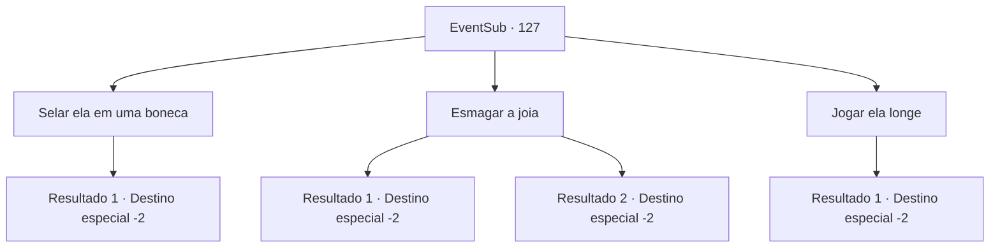

# Eventos secundários · 127

[Índice da tabela](index.md) · [Índice geral](../index.md)

ID: `pt:EventSub:127` · Fonte: `EventSub4` · Versão: 1.2.47.

Mapeamento estático dos arquivos; a disponibilidade e a execução dependem do estado da run.

## Texto do evento

*Sem texto no arquivo.*

## Dados de entrada

```json
{
  "id": 127,
  "grade": 1,
  "subEvent": "",
  "required": ""
}
```

## Mapa das escolhas



## Escolhas e resultados

### Escolha 1

Selar ela em uma boneca

Requisitos e outros campos da escolha:

```json
{
  "required": "1_7_11|8_185_1|20_0_1"
}
```

#### Resultado 1.1

Você percebe que a joia guarda a alma da rainha caída. Você a empurra para o urso de pelúcia que você ganhou de Delin antes que o Lich possa se regenerar. Então você rapidamente lança um feitiço nele para fazer da boneca o novo corpo dela. A boneca maltratada começa a se limpar, e seu olho direito também se regenera. 

 "Você ousa me transformar em um brinquedo de criança?! Eu vou te matar, mortal!"

 Tatia lança furiosamente uma série de feitiços de nevasca e relâmpago, mas nada funciona. O Lich fica frustrado além das palavras. Você empurra o urso de pelúcia mole para sua bolsa e continua sua jornada.

Continuação registrada: [Destino especial `-2`](../destinos-especiais.md).

```json
{
  "required": "",
  "chance": "1",
  "nextEvent": -2,
  "type": 2,
  "reward": "3_188_1|4_185_1|12_4_-1|14_4_6"
}
```

### Escolha 2

Esmagar a joia

Requisitos e outros campos da escolha:

```json
{
  "required": ""
}
```

#### Resultado 2.1

Você percebe que a joia guarda a alma da rainha caída. Você esmaga a joia antes que o Lich possa se regenerar. Um grito estridente rasga seus tímpanos enquanto uma fumaça branca sai da joia e desaparece no ar. Você deixa tudo para trás enquanto continua sua aventura.

Continuação registrada: [Destino especial `-2`](../destinos-especiais.md).

```json
{
  "required": "1_7_11",
  "chance": "1",
  "nextEvent": -2,
  "type": 2,
  "reward": "14_4_2|12_4_-1"
}
```

#### Resultado 2.2

Você não entende muito bem o que está acontecendo, mas mesmo assim esmague a gema. Um grito estridente rasga seus tímpanos enquanto uma fumaça branca sai da gema e desaparece no ar. Você deixa tudo para trás enquanto continua sua aventura.

Continuação registrada: [Destino especial `-2`](../destinos-especiais.md).

```json
{
  "required": "2_7_11",
  "chance": "1",
  "nextEvent": -2,
  "type": 2,
  "reward": "14_4_2|12_4_-1"
}
```

### Escolha 3

Jogar ela longe

Requisitos e outros campos da escolha:

```json
{
  "required": ""
}
```

#### Resultado 3.1

Você joga a joia bem longe. Então você chuta os ossos quebrados da rainha pela última vez, esperando nunca mais vê-la em sua jornada.

Continuação registrada: [Destino especial `-2`](../destinos-especiais.md).

```json
{
  "required": "",
  "chance": "1",
  "nextEvent": -2,
  "type": 2,
  "reward": "14_4_3|12_4_-1"
}
```

## Referências que chegam a este evento

- [Evento 126 · escolha 1 · resultado 1](0126.md#escolha-1)
